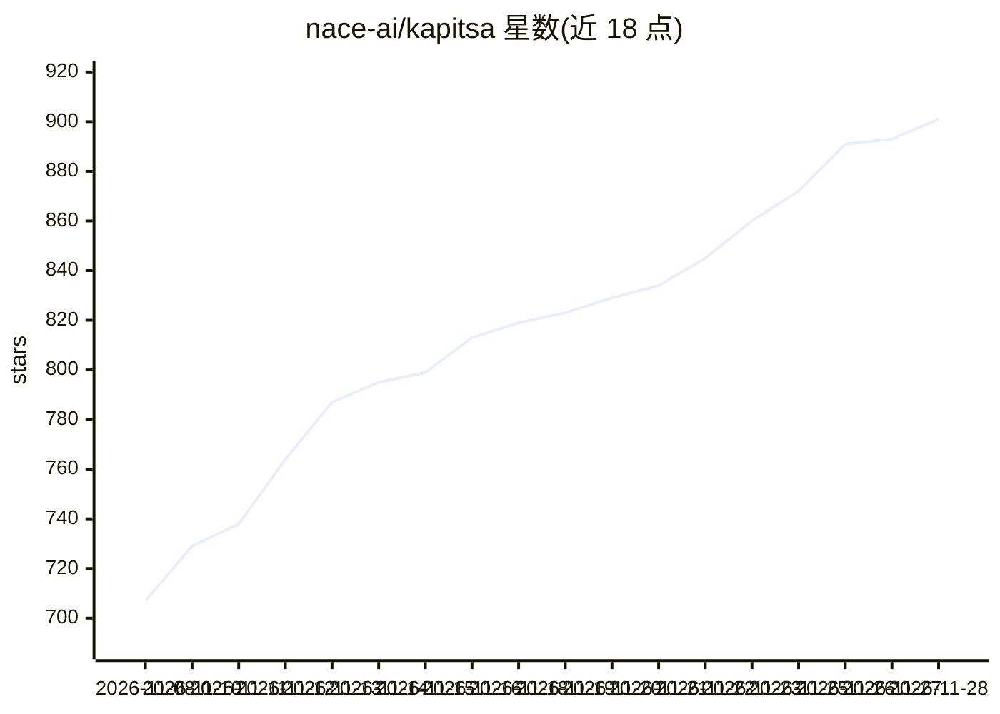

# nace-ai/kapitsa

⭐ 901 · C++ · Apache-2.0 · 推送 2026-11-27 · [GitHub](https://github.com/nace-ai/kapitsa) · [官网](https://kapitsa.vercel.app) · 组织维护

**Mac Apple 芯片本地 LLM 推理引擎，为编码 agent 提供服务**

面向 Apple Silicon 的本地推理引擎，运行 Qwen、Nemotron、Flint 等模型，提供 OpenAI 与 Anthropic 兼容 API 和本地聊天页。可一键在本地模型上启动 opencode、Claude Code、Codex、aider 等编码 agent。解码采用 KFlash 树形验证投机解码，GPU 与 Neural Engine 协同做 prefill，支持 SSD 流式加载大模型与多 Mac 协同分摊。仅支持 M1 及以上 Mac、macOS 14+，不支持 Linux/Windows；部分模型仅支持文本输入。

## 筛选速览

| 维度 | 判定 | 备注 |
|---|---|---|
| AI 角色 | `ai-ecosystem` | LLM/agent 周边工具 |
| 许可风险 | `permissive` | Apache-2.0 |
| 部署形态 | `None` |  |
| 模型依赖 | local-ok | 支持本地模型 |
| 硬件要求 | — | 无带数字的原话,不猜 |
| 安装摩擦 | `medium` | 含编译或系统依赖之一 |
| 成熟度 | — | 结构信号不足 |

## 能力要点

- OpenAI 与 Anthropic 兼容 API 服务于 127.0.0.1:8000，附带聊天页面
- 一条命令在本地模型上启动 opencode/Claude Code/Codex/aider/Goose 等编码 agent
- KFlash 投机解码：best-first 树验证草稿候选，输出不变
- 支持 SSD 流式加载（48 GB Mac 跑 180B）与多 Mac 协同运行同一模型

## 适用场景

- 在没有网络的 Mac 上本地运行编码 agent
- 为本地开发环境提供 OpenAI/Anthropic 格式的推理接口
- 在内存有限的 Mac 上运行大参数量模型
- 用 kapitsa bench 在自己机器上对比多个推理引擎

## 场景标签

`推理引擎` · 领域:训练与推理

## 证据(README 行号)

> L3: Kapitsa is an inference engine for Apple silicon that runs Qwen, Nemotron and Recursive's Flint models locally, buil
> L40: - 🔌 **OpenAI and Anthropic APIs**: plus a chat page, on `127.0.0.1:8000`
> L150: kapitsa serve                   # chat + OpenAI/Anthropic APIs at http://127.0.0.1:8000

## 星数曲线

2026-11-08 707 → 2026-11-28 901（+194）

---
*卡片 v1 · prompt 1.4 · 生成 2026-11-28 · 置信度 high · 依据 README sha `557093e72b00` · [字段定义](../../DATASET.md)*
