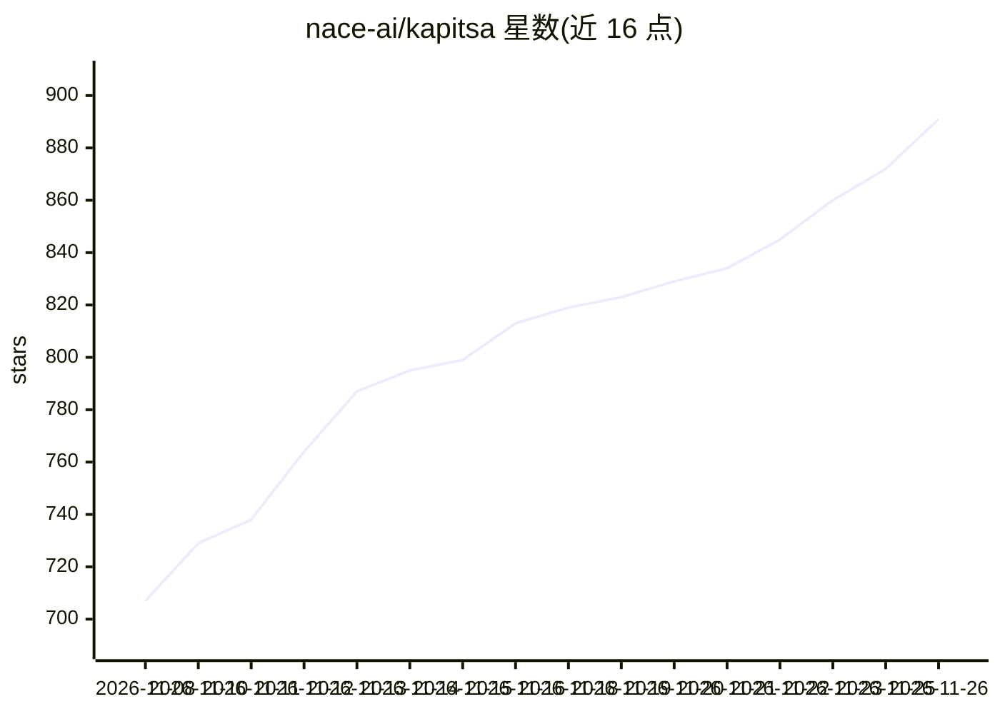

# nace-ai/kapitsa

⭐ 891 · C++ · Apache-2.0 · 推送 2026-11-25 · [GitHub](https://github.com/nace-ai/kapitsa) · [官网](https://kapitsa.vercel.app) · 组织维护

**Mac 用户本地运行 Qwen/Nemotron 模型并提供 OpenAI/Anthropic 兼容 API 的推理引擎**

面向 Apple Silicon 的本地推理引擎，可本地运行 Qwen、Nemotron、Flint 等模型，对编码 agent 场景做了优化：一条命令即可在本地模型上启动 opencode、Claude Code、Codex、aider、Goose 等 CLI agent，并在 127.0.0.1:8000 提供 OpenAI 与 Anthropic 兼容 API 及聊天页面。解码采用 KFlash 树形投机校验机制，prefill 部分任务交给 Neural Engine；支持多 Mac 协同加载放不下的模型、SSD 流式加载大权重、C ABI SDK 与 Node.js 绑定。仅支持 Apple Silicon Mac（M1 及以上、macOS 14+），不含 Linux/Windows。

## 筛选速览

| 维度 | 判定 | 备注 |
|---|---|---|
| AI 角色 | `ai-ecosystem` | LLM/agent 周边工具 |
| 许可风险 | `permissive` | Apache-2.0 |
| 部署形态 | `None` |  |
| 模型依赖 | — | README 未给出锁定关系 |
| 硬件要求 | — | 无带数字的原话,不猜 |
| 安装摩擦 | `medium` | 含编译或系统依赖之一 |
| 成熟度 | — | 结构信号不足 |

## 能力要点

- 一条命令在本地模型上启动 Claude Code、Codex、opencode、aider、Goose 等 agent
- 提供 OpenAI 与 Anthropic 兼容 API 与本地聊天页面
- KFlash 树形投机解码，GPU 与 Neural Engine 协同做 prefill
- 多 Mac 协同加载与 SSD 流式读取超大模型权重

## 适用场景

- 在没有外网 API 的 Mac 上给 Claude Code/Codex 等 agent 接本地模型
- 本地部署 OpenAI/Anthropic 兼容 API 给桌面客户端调用
- 在内存较小的 Mac 上跑超出内存的大参数量化模型
- 用 kapitsa bench 测量并对比本机各引擎的推理速度

## 场景标签

`推理引擎` · 领域:训练与推理

## 证据(README 行号)

> L3: Kapitsa is an inference engine for Apple silicon that runs Qwen, Nemotron and Recursive's Flint models locally, buil
> L150: kapitsa serve                   # chat + OpenAI/Anthropic APIs at http://127.0.0.1:8000

## 星数曲线

2026-11-08 707 → 2026-11-26 891（+184）

---
*卡片 v1 · prompt 1.4 · 生成 2026-11-25 · 置信度 high · 依据 README sha `f0ca632c4550` · [字段定义](../../DATASET.md)*
