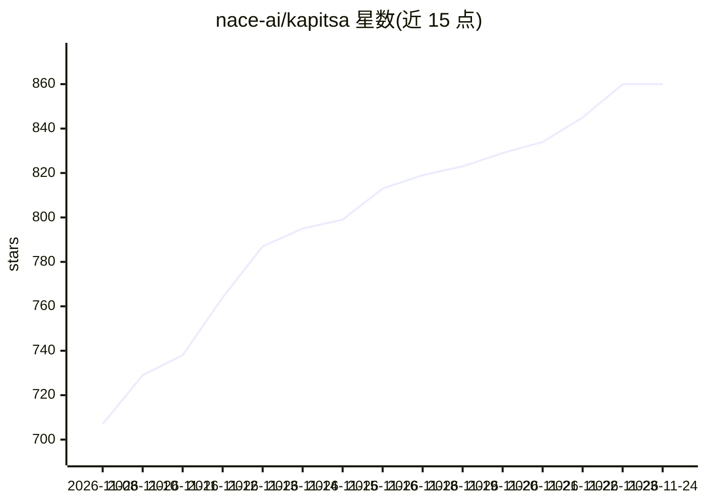

# nace-ai/kapitsa

⭐ 872 · C++ · Apache-2.0 · 推送 2026-11-23 · [GitHub](https://github.com/nace-ai/kapitsa) · [官网](https://kapitsa.vercel.app) · 组织维护

**Apple Silicon 本地推理引擎：为编码 agent 运行本地 LLM**

面向 Apple Silicon Mac 的本地推理引擎，运行 Qwen、Nemotron、Flint 等模型本地推理，可直接启动 opencode、Claude Code、Codex、aider、Goose 等编码 agent 使用本地模型，并在 127.0.0.1:8000 提供 OpenAI 与 Anthropic 兼容 API 及聊天页。解码采用 KFlash：在草稿模型候选上做 best-first 树校验，声称改变速度但不改变输出。仅支持 Apple Silicon（M1+）与 macOS 14+，无 Linux/Windows；通过 Homebrew tap 或安装脚本安装。

## 筛选速览

| 维度 | 判定 | 备注 |
|---|---|---|
| AI 角色 | `ai-ecosystem` | LLM/agent 周边工具 |
| 许可风险 | `permissive` | Apache-2.0 |
| 部署形态 | `None` |  |
| 模型依赖 | locked-api |  |
| 硬件要求 | — | 无带数字的原话,不猜 |
| 安装摩擦 | `medium` | 含编译或系统依赖之一 |
| 成熟度 | — | 结构信号不足 |

## 能力要点

- 本地运行模型并提供 OpenAI/Anthropic 兼容 API
- kapitsa claude/codex/opencode 等命令一键在本地模型上启动编码 agent
- KFlash 树校验解码、GPU 与 Neural Engine 协同
- 多 Mac 组网：内存不足的 Mac 可调用另一台 Mac 上的模型

## 适用场景

- 在 Mac 上为 Claude Code/Codex 等 agent 接本地模型
- 本地部署 OpenAI/Anthropic 兼容 API 供开发使用
- 在内存较小的 Mac 上运行大参数模型（SSD 流式权重）

## 场景标签

`推理引擎` · 领域:训练与推理

## 证据(README 行号)

> L3: Kapitsa is an inference engine for Apple silicon that runs Qwen, Nemotron and Recursive's Flint models locally, buil
> L9: **Requirements:** a Mac with Apple silicon (M1 or newer) and macOS 14 Sonoma or later.
> L150: kapitsa serve                   # chat + OpenAI/Anthropic APIs at http://127.0.0.1:8000

## 星数曲线

2026-11-08 707 → 2026-11-24 860（+153）

---
*卡片 v1 · prompt 1.4 · 生成 2026-11-24 · 置信度 high · 依据 README sha `58b239540ea9` · [字段定义](../../DATASET.md)*
