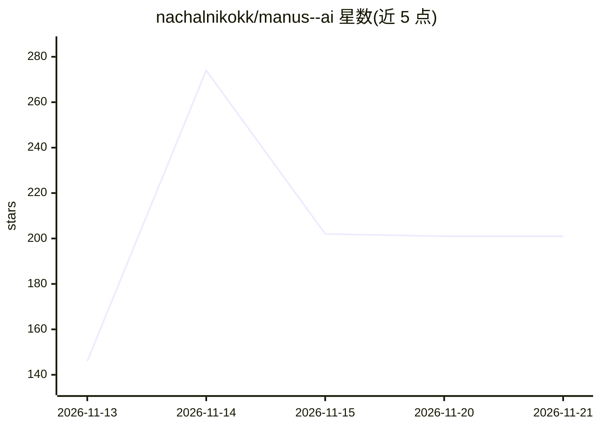

# nachalnikokk/manus--ai

⭐ 201 · Apache-2.0 · 推送 2026-11-17 · [GitHub](https://github.com/nachalnikokk/manus--ai) · 个人维护

**面向个人用户的自主 AI Agent：代跑代码与操控浏览器**

README 以宣传文案形式描述一个名为 Manus 的自主 AI Agent：用户用自然语言下达指令，代理自行编写并执行脚本、打开网页、填写表单、完成多步骤任务，覆盖学习研究、家庭事务与轻量办公场景，并称可在后台常驻与跨会话复用工作流。README 给出 CPU/内存等兼容性表格与使用步骤说明，但未提供任何安装命令、代码仓库内容说明或架构细节，也未说明所依赖的模型与 API。定位为小型任务助手，非企业平台。

## 筛选速览

| 维度 | 判定 | 备注 |
|---|---|---|
| AI 角色 | `ai-native` | 本体是模型或模型工具 |
| 许可风险 | `permissive` | Apache-2.0 |
| 部署形态 | `None` |  |
| 模型依赖 | — | README 未给出锁定关系 |
| 硬件要求 | — | 无带数字的原话,不猜 |
| 安装摩擦 | `low` | 无编译、无系统依赖或容器化 |
| 成熟度 | — | 结构信号不足 |

## 能力要点

- 自主执行代码与浏览器控制相结合的多步骤任务代理
- 面向非开发者的自然语言任务委派
- README 列出最低/推荐硬件兼容性表

## 适用场景

- 让学生整理研究笔记、跑小脚本
- 让代理替我浏览网页收集信息、填表
- 日常小事的后台自动化委派

## 场景标签

`浏览器自动化` `AI 助手` · 领域:效率与自动化

## 证据(README 行号)

> L10: - **Autonomous Code Execution:** Manus AI agent runs code on its own to complete tasks, so you can focus on decisio
> L18: Manus is an autonomous AI agent designed to run code and control a browser on your behalf. Instead of acting like a

## 星数曲线

2026-11-13 146 → 2026-11-21 201（+55）

---
*卡片 v1 · prompt 1.4 · 生成 2026-11-18 · 置信度 mid · 依据 README sha `c06e59c45084` · [字段定义](../../DATASET.md)*
