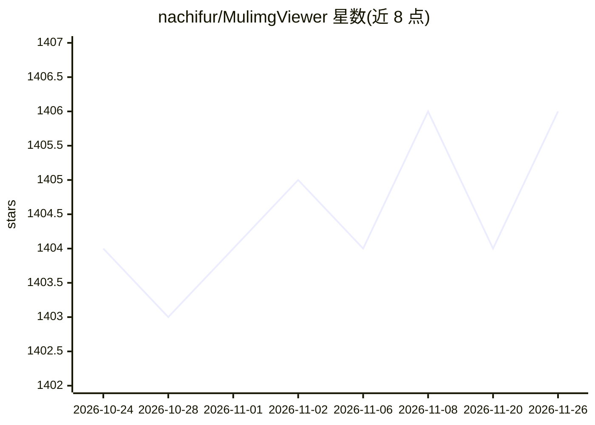

# nachifur/MulimgViewer

⭐ 1,406 · Python · GPL-3.0 · 推送 2026-11-25 · [GitHub](https://github.com/nachifur/MulimgViewer) · [官网](https://mulimgviewer.readthedocs.io/) · 个人维护 · 中文 README

**多图像浏览器：一个界面并排比较、拼接多张图片**

用 Python 编写的多图像浏览器，在一个界面内从多个文件夹加载图像并并排显示，提供并行挑选、并行放大、纵向横向拼接与自动拼接保存、成对数据浏览、点按旋转、批量 resize 等功能。面向需要浏览和比较大量图片的用户，如浏览 CelebA 数据库（一次显示 1000 张）与生成论文对比图。支持远程目录挂载浏览（Ubuntu nautilus、Win10 SSHFS-Win）。个人使用免费，商业使用需联系作者。

## 筛选速览

| 维度 | 判定 | 备注 |
|---|---|---|
| AI 角色 | `ai-enhanced` | 去掉 AI 部分产品仍成立 |
| 许可风险 | `viral` | GPL-3.0 |
| 部署形态 | `None` |  |
| 模型依赖 | — | README 未给出锁定关系 |
| 硬件要求 | — | 无带数字的原话,不猜 |
| 安装摩擦 | `low` | 无编译、无系统依赖或容器化 |
| 成熟度 | — | 结构信号不足 |

## 能力要点

- 一个界面并排显示多张图像，支持同时放大多个区域
- 并行挑选：一键保存/剪切需要对比的多张图像
- 纵向与横向拼接，支持自动拼接保存与多框并行放大
- 支持远程挂载目录图片浏览与批量化 resize

## 适用场景

- 浏览几十万张规模的数据集图片并逐页筛选
- 对比不同模型或方法生成的图像并导出论文对比图
- 对成对数据（如原图与结果图）进行并排浏览
- 批量将图片 resize 到固定尺寸并保存

## 场景标签

`图像视频处理` · 领域:感知与多模态

## 证据(README 行号)

> L24: MulimgViewer**多图像浏览器**，在一个界面显示多个图像，方便图像的比较、筛选。
> L109: GPL-3.0 License：https://www.gnu.org/licenses/gpl-3.0.en.html

## 星数曲线

2026-10-24 1,404 → 2026-11-26 1,406（+2）

---
*卡片 v1 · prompt 1.4 · 生成 2026-11-26 · 置信度 mid · 依据 README sha `d9627ba7c33f` · [字段定义](../../DATASET.md)*
