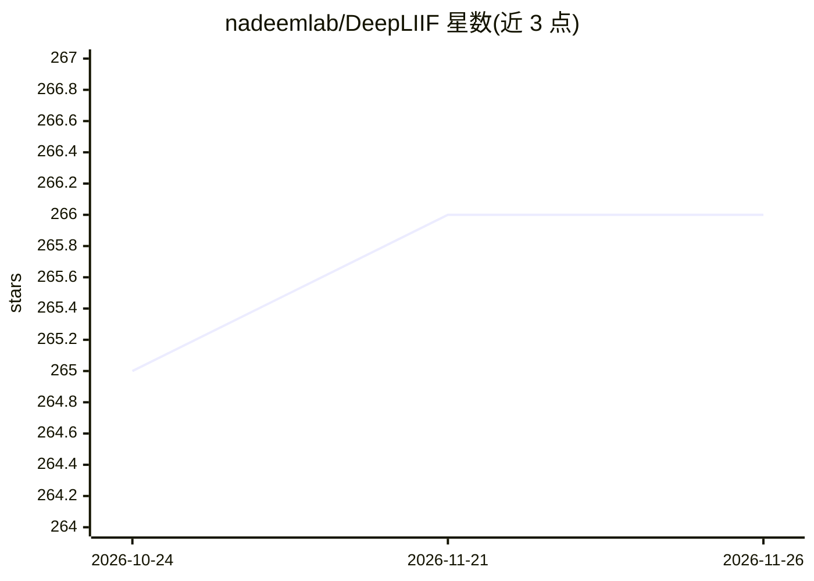

# nadeemlab/DeepLIIF

⭐ 266 · Python · NOASSERTION · 推送 2026-11-23 · [GitHub](https://github.com/nadeemlab/DeepLIIF) · [官网](https://deepliif.org) · 组织维护

**IHC 病理图像的染色解卷积、细胞分割与定量评分工具**

DeepLIIF 是一个多任务深度学习框架，对免疫组化（IHC）图像执行染色解卷积/分离、细胞分割与单细胞 IHC 定量评分，并可从 IHC 图像推断对应的 mpIF 通道；基于配准的 IHC 与 mpIF 数据集训练，支持 Ki67、CD3、CD8 等多种标记物。本地运行需 GPU，可通过 pip 安装并使用 deepliif CLI；也可通过 deepliif.org 网站、云 API 或 ImageJ/Fiji 插件远程使用（无需 GPU）。代码仅限非商业学术用途。

## 筛选速览

| 维度 | 判定 | 备注 |
|---|---|---|
| AI 角色 | `ai-native` | 本体是模型或模型工具 |
| 许可风险 | `none` | NOASSERTION |
| 部署形态 | `self-host` | docker 或自建部署 |
| 模型依赖 | local-ok | 支持本地模型 |
| 硬件要求 | — | 无带数字的原话,不猜 |
| 安装摩擦 | `low` | 无编译、无系统依赖或容器化 |
| 成熟度 | — | 结构信号不足 |

## 能力要点

- 多任务框架同时完成染色分离、细胞分割与阳性/阴性分类
- 支持单/多 GPU 训练（DP 与 DDP）与 Torchscript 序列化
- 提供 OpenVINO int8 量化以支持 CPU 推理
- 云原生平台支持 150+ 输入图像格式（Bioformats）

## 适用场景

- 对 IHC 病理切片做定量单细胞评分
- 将 IHC 图像转换为 mpIF 通道用于蛋白表达分析
- 在 H&E 图像上开箱即用地做细胞核分割
- 训练自有数据集的病理图像分割模型

## 场景标签

`目标检测` `图像视频处理` · 领域:感知与多模态

## 证据(README 行号)

> L23: By creating a multitask deep learning framework referred to as DeepLIIF, we present a single-step solution to stain
> L36: **DeepLIIF** is deployed as a free publicly available cloud-native platform (https://deepliif.org) with Bioformats 

## 星数曲线

2026-10-24 265 → 2026-11-26 266（+1）

---
*卡片 v1 · prompt 1.4 · 生成 2026-11-25 · 置信度 mid · 依据 README sha `0f07e560c34b` · [字段定义](../../DATASET.md)*
