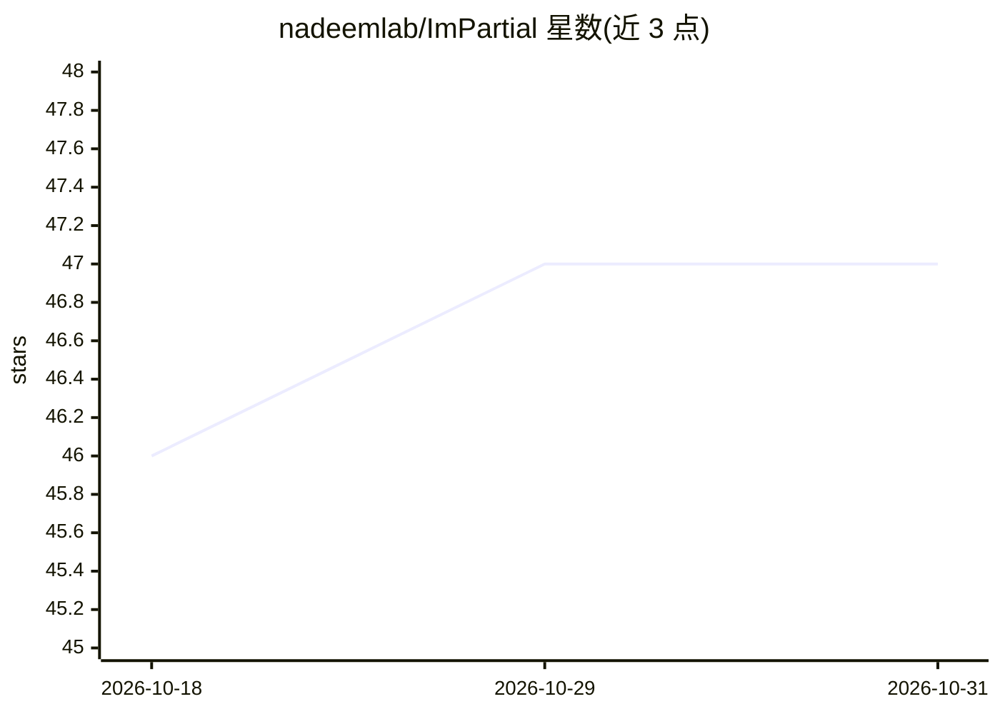

# nadeemlab/ImPartial

⭐ 47 · Python · NOASSERTION · 推送 2026-09-29 · [GitHub](https://github.com/nadeemlab/ImPartial) · 组织维护

**病理图像细胞分割框架：稀疏涂鸦标注下交互式深度学习分割**

面向病理与多重免疫成像的实例分割深度学习框架：以稀疏 scribbles 部分标注与自监督多通道量化插补增强分割目标，声称在低标注量下达到接近全监督模型的性能。提供 MONAI-Label 后端（RESTful API、主动学习迭代）、ImageJ/Fiji 插件客户端与 AWS 云部署，支持多用户注册认证与无代码执行；也可本地或 HPC 运行。代码以 Apache 2.0 with Commons Clause 分发，限非商业学术用途。

## 筛选速览

| 维度 | 判定 | 备注 |
|---|---|---|
| AI 角色 | `ai-native` | 本体是模型或模型工具 |
| 许可风险 | `none` | NOASSERTION |
| 部署形态 | `self-host` | docker 或自建部署 |
| 模型依赖 | — | README 未给出锁定关系 |
| 硬件要求 | — | 无带数字的原话,不猜 |
| 安装摩擦 | `low` | 无编译、无系统依赖或容器化 |
| 成熟度 | — | 结构信号不足 |

## 能力要点

- 稀疏涂鸦部分标注下的深度学习细胞分割
- 自监督多通道量化插补增强分割目标
- MONAI-Label 后端 + ImageJ/Fiji 插件的人机交互主动学习流程
- 支持本地/HPC/AWS 云部署，无代码执行与多用户会话

## 适用场景

- 在标注稀缺的多重免疫成像数据上做细胞实例分割
- 通过 Fiji 涂鸦标注迭代微调分割模型
- 在云端或本地部署无代码的交互式分割服务

## 场景标签

`目标检测` · 领域:感知与多模态

## 证据(README 行号)

> L8: Accurate cell segmentation in pathology images typically requires dense pixel-wise annotations, which are costly and
> L31: We have transitioned from research to a production-ready environment/workflow, where in the user can upload images,

## 星数曲线

2026-10-18 46 → 2026-10-31 47（+1）

---
*卡片 v1 · prompt 1.4 · 生成 2026-10-25 · 置信度 high · 依据 README sha `eb8020b25376` · [字段定义](../../DATASET.md)*
