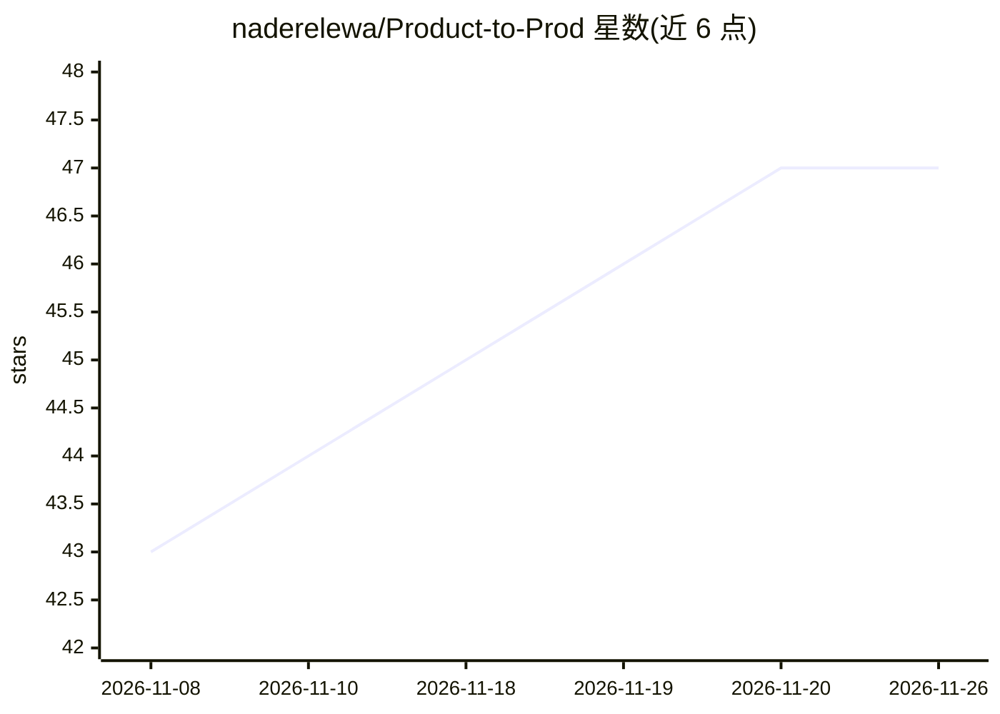

# naderelewa/Product-to-Prod

⭐ 47 · Shell · MIT · 推送 2026-11-25 · [GitHub](https://github.com/naderelewa/Product-to-Prod) · [官网](https://naderelewa.com) · 个人维护

**面向 AI agent 的产品管理技能插件：从需求到发布产出证据标注文档**

以 Claude Code 插件/Agent Skills 形式运行的产品管理工具集：通过 /pm-start 访谈锁定上下文后路由到具体动词，产出带证据标签的 PRD、规格、RICE 优先级排序、分阶段 GTM 计划与发布验证（对部署后构建只读评分）。关键机制：六类证据标签、机械执行的标签 linter、审批标志默认 false 且本插件无代码路径写 true，89 项自检。本地运行，usage log 默认关闭。限制：无 SaaS UI、单人使用、v0.1.3。

## 筛选速览

| 维度 | 判定 | 备注 |
|---|---|---|
| AI 角色 | `ai-native` | 本体是模型或模型工具 |
| 许可风险 | `permissive` | MIT |
| 部署形态 | `None` |  |
| 模型依赖 | — | README 未给出锁定关系 |
| 硬件要求 | — | 无带数字的原话,不猜 |
| 安装摩擦 | `low` | 无编译、无系统依赖或容器化 |
| 成熟度 | `idea` | |

## 能力要点

- 每条事实声明带六类证据标签之一，linter 机械检查
- 审批标志 fail-closed：无代码路径将其写为 true
- 7 个技能：4 个工作动词 + /pm-start 调度器 + 框架库 + init
- 89 项自检测试套件与只读遥测验证

## 适用场景

- 让 AI agent 按证据纪律起草 PRD 与规格文档
- 为积压需求做证据标注的 RICE 优先级排序
- 制定分阶段门控的 GTM 发布计划并对上线结果做只读验证
- 在 Claude Code 或兼容 Agent Skills 规范的 harness 中本地运行

## 场景标签

`AI 写作` · 领域:内容生成

## 证据(README 行号)

> L7: - **PRDs, specs and use cases** - `/pm-requirements-v1` emits the spec-kit: spec, plan, data model, contracts and ac
> L13: **Every claim in what it writes is either sourced or labelled unsourced, and no gate is passed by the agent that wa
> L88: Prerequisite: python3 on your path, and `shasum` (or `sha256sum`) for the requirements seal. Most scripts embed a p

## 星数曲线

2026-11-08 43 → 2026-11-26 47（+4）

---
*卡片 v1 · prompt 1.4 · 生成 2026-11-18 · 置信度 high · 依据 README sha `97194b4fb4f1` · [字段定义](../../DATASET.md)*
