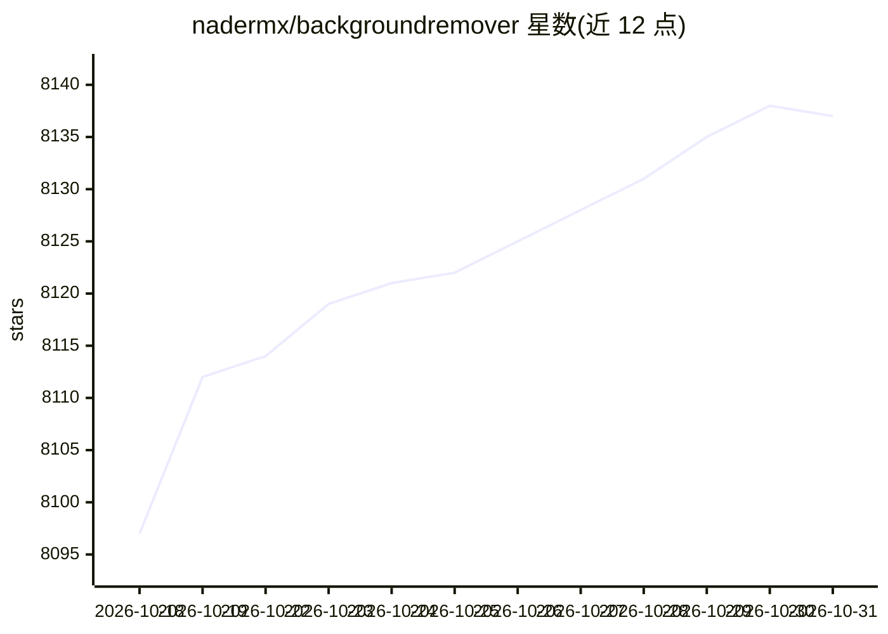

# nadermx/backgroundremover

⭐ 8,137 · Python · MIT · 推送 2026-07-10 · [GitHub](https://github.com/nadermx/backgroundremover) · [官网](https://backgroundremoverai.com) · 个人维护

**用 AI 抠除图片与视频背景的命令行工具**

基于 U-Net（u2net/u2netp/u2net_human_seg）模型的抠图工具，以 CLI 形式提供，也支持作为 Python 库和 HTTP API 服务调用。支持 jpg/png/heic 等图片与 mp4/mov/webm/gif 等视频，可输出透明 mov（默认 ProRes 4444）、透明 gif、matte 文件，或替换背景为纯色/图片/视频；提供 alpha matting 边缘精修、批处理文件夹、stdin/stdout 管道模式。依赖 Python 3.6+、torch/torchvision 与 ffmpeg 4.4+，首次运行自动下载 u2net 模型；GPU 可自动检测使用，无 GPU 时回退 CPU。由个人开发者维护，用于驱动 BackgroundRemoverAI.com。

## 筛选速览

| 维度 | 判定 | 备注 |
|---|---|---|
| AI 角色 | `ai-native` | 本体是模型或模型工具 |
| 许可风险 | `permissive` | MIT |
| 部署形态 | `desktop` | 安装包/桌面程序 |
| 模型依赖 | — | README 未给出锁定关系 |
| 硬件要求 | `cpu-ok` | |
| 安装摩擦 | `low` | 无编译、无系统依赖或容器化 |
| 成熟度 | — | 结构信号不足 |

## 能力要点

- u2net 系列三种模型可选，含人像专用 u2net_human_seg
- 视频抠像输出透明 mov（ProRes 4444/WebM/qtrle 可选）、gif 与 matte 文件
- 支持 CLI、Python 库、HTTP API server 与 stdin/stdout 管道四种使用方式
- alpha matting 边缘精修与背景替换（纯色/图片/视频）

## 适用场景

- 批量给产品图或人像照片去背景
- 给视频去背景并输出透明 mov 供剪辑软件使用
- 把去背景能力作为 HTTP API 接入自己的服务

## 场景标签

`图像视频处理` · 领域:感知与多模态

## 证据(README 行号)

> L3: background remover video
> L202: - `model` - Model choice: `u2net`, `u2netp`, or `u2net_human_seg`

## 星数曲线

2026-10-18 8,097 → 2026-10-31 8,137（+40）

---
*卡片 v1 · prompt 1.4 · 生成 2026-10-20 · 置信度 high · 依据 README sha `d3a4ec5c9e6d` · [字段定义](../../DATASET.md)*
