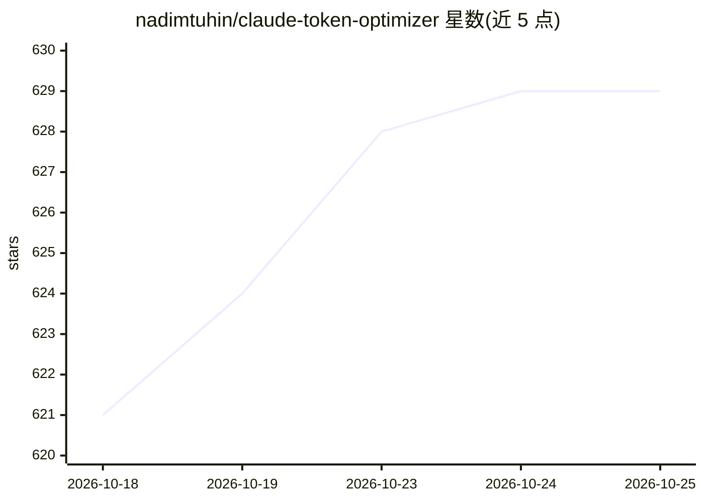

# nadimtuhin/claude-token-optimizer

⭐ 629 · JavaScript · MIT · 推送 2026-10-20 · [GitHub](https://github.com/nadimtuhin/claude-token-optimizer) · [官网](https://www.npmjs.com/package/claude-token-optimizer) · 个人维护

**缩减 Claude Code 会话启动加载 token 的 CLI 工具**

面向 Claude Code 用户的 npm CLI（命令 cto）：重写 CLAUDE.md 为简短入口文件，将旧会话笔记与已完成任务移入按需读取的侧文件（.claudeignore、docs/INDEX.md 等），作者项目实测启动 token 从约 11,000 降至约 800。提供 measure 逐文件计量、audit 的 19 项结构检查（可接 CI）、compress/prune 确定性压缩归档、实时面板 watch，以及 12 个 Claude Code hook 模板做持续约束。需 Node 20+；输出为纯 markdown，其他 agent 可读但 token 计数与 ignore 规则仅针对 Claude Code；token 数基于 Claude 2 分词器，为估计值。

## 筛选速览

| 维度 | 判定 | 备注 |
|---|---|---|
| AI 角色 | `ai-ecosystem` | LLM/agent 周边工具 |
| 许可风险 | `permissive` | MIT |
| 部署形态 | `library` | 以包/库形式分发 |
| 模型依赖 | — | README 未给出锁定关系 |
| 硬件要求 | — | 无带数字的原话,不猜 |
| 安装摩擦 | `low` | 无编译、无系统依赖或容器化 |
| 成熟度 | — | 结构信号不足 |

## 能力要点

- cto init 生成简短 CLAUDE.md + 按需读取的侧文件结构
- measure/audit/watch 等 token 计量与 CI 检查命令
- 12 个 hook 模板（PreToolUse/UserPromptSubmit/Stop 等事件）
- 支持 12+ 框架模板检测（package.json/go.mod/Gemfile 等）

## 适用场景

- 降低 Claude Code 每次会话启动的 token 消耗与费用
- 在 CI 中用 cto audit 防止文档体积回涨
- 用 hook 模板在会话中持续拦截大文件读取与超标加载

## 场景标签

`提示工程` · 领域:Agent 开发

## 证据(README 行号)

> L24: npx -y claude-token-optimizer measure
> L137:   CLAUDE.md                   Claude reads this first

## 星数曲线

2026-10-18 621 → 2026-10-25 629（+8）

---
*卡片 v1 · prompt 1.4 · 生成 2026-10-22 · 置信度 high · 依据 README sha `b0e9f9fd99d3` · [字段定义](../../DATASET.md)*
