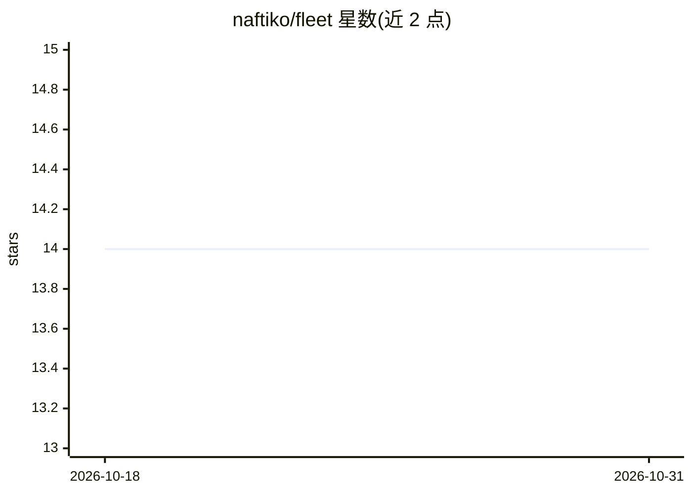

# naftiko/fleet

⭐ 14 · NOASSERTION · 推送 2026-10-26 · [GitHub](https://github.com/naftiko/fleet) · [官网](https://shipyard.naftiko.io/fleet/) · 组织维护

**面向开发团队的 Spec 驱动 API 集成平台（三组件）**

Naftiko Fleet 是面向开发者、团队和企业的 Spec-Driven Integration 平台，覆盖从编写能力（capability）到规模化运营治理的全流程。由三个可独立使用的组件组成：Crafter（VS Code 兼容 IDE 扩展，编辑并 lint Ikanos 规范）、Warden（Backstage 集成，负责编目、脚手架与交付）、Skipper（Kubernetes 集成，部署运营能力集群）。平台依赖的 Ikanos 与 Polychro 为 Apache 2.0 开源；提供无需安装的在线 Playground 教程。

## 筛选速览

| 维度 | 判定 | 备注 |
|---|---|---|
| AI 角色 | `ai-ecosystem` | LLM/agent 周边工具 |
| 许可风险 | `none` | NOASSERTION |
| 部署形态 | `None` |  |
| 模型依赖 | — | README 未给出锁定关系 |
| 硬件要求 | — | 无带数字的原话,不猜 |
| 安装摩擦 | `low` | 无编译、无系统依赖或容器化 |
| 成熟度 | — | 结构信号不足 |

## 能力要点

- 三组件架构：Crafter/VS Code 扩展、Warden/Backstage 集成、Skipper/Kubernetes 集成
- 各组件可独立采用，不要求互相依赖
- 核心依赖 Ikanos 与 Polychro 均为 Apache 2.0 开源
- 提供在线 Playground 三条教程轨道（上下文工程/API 复用/API 编排）

## 适用场景

- 在 IDE 中编写并 lint Ikanos 规范以定义 API 能力
- 通过 Backstage 编目、脚手架化并交付 API 能力
- 在 Kubernetes 上部署并运营一组受治理的能力

## 场景标签

`代码生成` · 领域:编码与开发

## 证据(README 行号)

> L3: Welcome to the **Naftiko Fleet**, the Enterprise platform for Spec-Driven Integration — reinventing API integration 
> L9: The Naftiko Fleet delivers Spec-Driven Integration **end to end**, from authoring a capability to operating and gove
> L13:  - Skipper is a **Kubernetes integration** to deploy and operate a fleet of capabilities.

## 星数曲线

2026-10-18 14 → 2026-10-31 14（+0）

---
*卡片 v1 · prompt 1.4 · 生成 2026-10-31 · 置信度 mid · 依据 README sha `5253edf7ea7a` · [字段定义](../../DATASET.md)*
