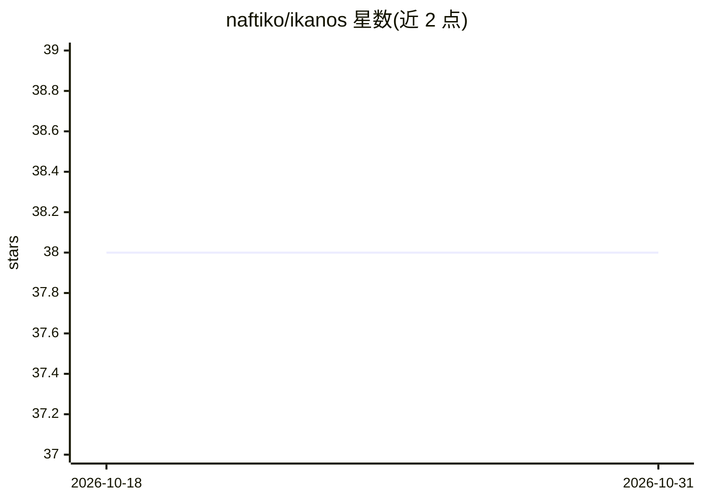

# naftiko/ikanos

⭐ 38 · Java · NOASSERTION · 推送 2026-10-30 · [GitHub](https://github.com/naftiko/ikanos) · [官网](https://ikanos.io) · 个人维护

**把现有 HTTP API 声明为 YAML 能力并同时暴露 MCP/REST/Skill 的引擎**

Ikanos 是面向 Spec-Driven Integration 的开源能力引擎：读取一个 YAML 文件描述业务切片（如 customers/orders），消费已有的 HTTP/REST API，将其响应结构化为 JSON，再聚合与编排为统一契约，通过 MCP、Skill、REST、Control 多协议同时提供给 AI agent、Web 应用与合作伙伴。无需编写或编译代码。支持 Bearer/OAuth 2.1 等认证、多种数据格式转 JSON、沙盒内联脚本（GraalVM 运行 JavaScript/Python/Groovy）、OpenAPI 导入导出。声明范围外：非代码生成器、非工作流引擎、非服务网格。以单一 Docker 镜像或原生二进制提供。

## 筛选速览

| 维度 | 判定 | 备注 |
|---|---|---|
| AI 角色 | `ai-ecosystem` | LLM/agent 周边工具 |
| 许可风险 | `none` | NOASSERTION |
| 部署形态 | `None` |  |
| 模型依赖 | — | README 未给出锁定关系 |
| 硬件要求 | — | 无带数字的原话,不猜 |
| 安装摩擦 | `low` | 无编译、无系统依赖或容器化 |
| 成熟度 | `idea` | |

## 能力要点

- YAML 声明能力，无需编写代码即可生成 MCP/REST/Skill 多协议服务
- 消费既有 HTTP API 并把 Protobuf/XML/CSV/Avro 等格式转为结构化 JSON
- OpenAPI 导入（Swagger 2.0、OAS 3.0/3.1）与 REST 适配器导出
- OTel tracing、RED 指标、Prometheus 抓取，单 Docker 镜像交付

## 适用场景

- 为 AI agent 提供受治理的 MCP 工具而无需编写 handler
- 在杂乱或遗留端点前放置统一的治理契约
- 一份领域 spec 同时服务 REST、MCP 与 Skill 多类客户端

## 场景标签

 · 领域:API 集成/agent 基础设施

## 证据(README 行号)

> L8: **Ikanos** is the open source capability engine for Spec-Driven Integration.
> L10: It reads one YAML file describing a slice of your business — say *customers* or *orders*. A capability **consumes**
> L14: - :robot: **You're building AI agents** — give agents governed MCP tools without writing handlers, and send the mod

## 星数曲线

2026-10-18 38 → 2026-10-31 38（+0）

---
*卡片 v1 · prompt 1.4 · 生成 2026-10-25 · 置信度 high · 依据 README sha `367a57a0337f` · [字段定义](../../DATASET.md)*
