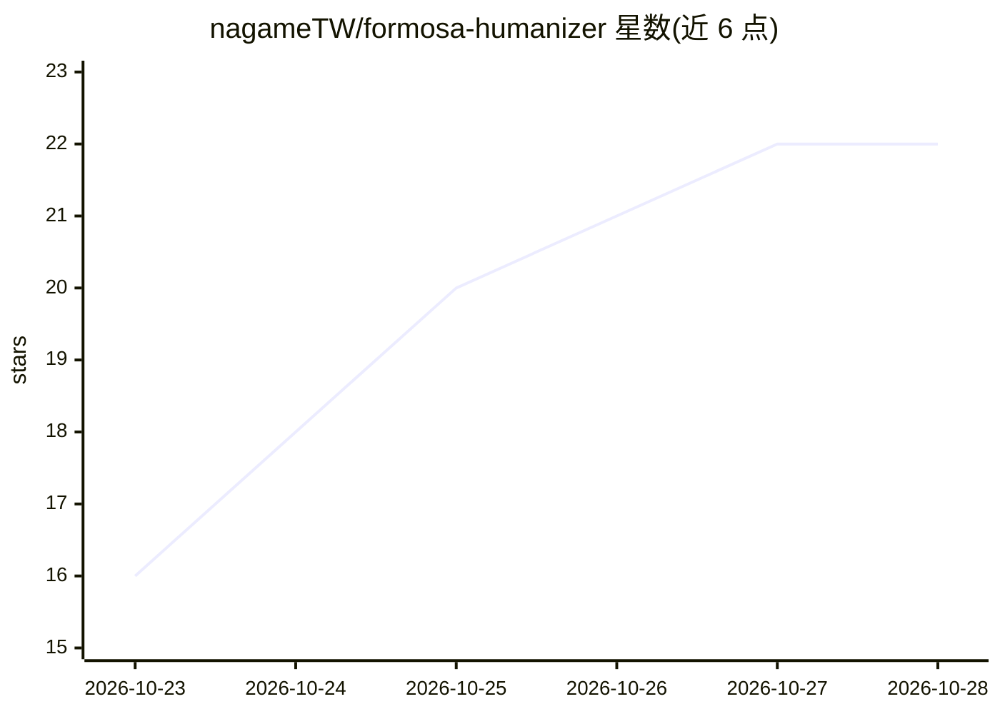

# nagameTW/formosa-humanizer

⭐ 22 · Markdown · MIT · 推送 2026-10-22 · [GitHub](https://github.com/nagameTW/formosa-humanizer) · 个人维护 · 中文 README

**把 AI 写的繁体中文改写为台湾用语风格的 Claude 技能**

以 blader/humanizer 为基础、按台湾用语与中文标点从头改写的 agent skill：通过 49 种模式侦测并改写 AI 写作痕迹，含中国用语侦测、标点西化、填充短语等中文专属类别，只改写给它的散文文字，不生成、不扩写内容，也不保证通过 GPTZero 等统计式 AI 侦测器。以 SKILL.md 形式提供，可装入 Claude Code、Codex CLI、Claude.ai、Claude Desktop，其他界面可整份贴入当提示词，但文件模式不运作。

## 筛选速览

| 维度 | 判定 | 备注 |
|---|---|---|
| AI 角色 | `ai-native` | 本体是模型或模型工具 |
| 许可风险 | `permissive` | MIT |
| 部署形态 | `library` | 以包/库形式分发 |
| 模型依赖 | locked-api |  |
| 硬件要求 | — | 无带数字的原话,不猜 |
| 安装摩擦 | `low` | 无编译、无系统依赖或容器化 |
| 成熟度 | — | 结构信号不足 |

## 能力要点

- 49 种模式的 AI 写作痕迹侦测与改写，含 5 类中文专属模式
- 中国用语侦测与两岸用语对照表
- 保留「」引号，不做英文引号替换
- 指向文件时只改散文，不碰程序代码块与 frontmatter

## 适用场景

- 我把 AI 生成的繁中文章改成台湾人自然的用语和标点
- 清理文档里混入的中国用语
- 让 AI 帮公告或文章去掉 AI 味但保留原意

## 场景标签

`AI 写作` `提示工程` · 领域:Agent 开发

## 证据(README 行号)

> L6: 把 AI 寫的中文改得像台灣人寫的。英文原版 blader/humanizer 和簡中版的規則都不是為繁中寫的，本版照台灣用語和中文標點從頭改過。他會找出混進文字裡的中國用語，也不會把「」換成英文引號。與原版的差異見 docs/de
> L8: 他只拿掉明顯的 AI 習慣，不補原文沒寫的內容。適用於能載入 skill 的環境，例如 Claude Code、Codex CLI、Claude.ai 與 Claude Desktop。其他聊天介面可以把 `SKILL.md` 整份
> L102: ├── SKILL.md                  # 技能本體，agent 讀取的指令

## 星数曲线

2026-10-23 16 → 2026-10-28 22（+6）

---
*卡片 v1 · prompt 1.4 · 生成 2026-10-27 · 置信度 high · 依据 README sha `7e3d3fa1a331` · [字段定义](../../DATASET.md)*
