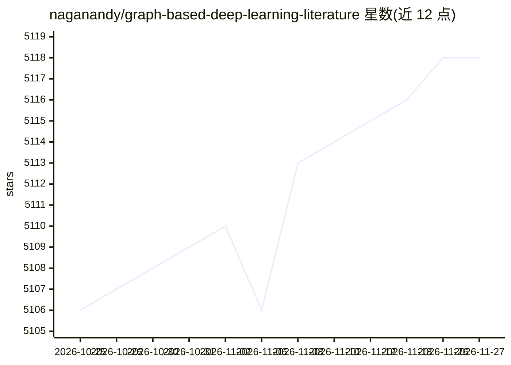

# naganandy/graph-based-deep-learning-literature

⭐ 5,118 · Jupyter Notebook · MIT · 推送 2026-10-20 · [GitHub](https://github.com/naganandy/graph-based-deep-learning-literature) · 个人维护

**图深度学习会议论文链接汇总清单，供研究者查阅**

以链接列表形式维护的图深度学习文献索引：按会议（NeurIPS、ICML、ICLR、KDD、AAAI、CVPR、ACL 等）与年份组织论文链接，会议内再按主题分类；另附相关研讨会、综述/书籍、软件与库的链接，以及 GNN 领域被引最高的 10 篇论文清单。仓库本身不含代码或模型，仅提供文献导航，面向图神经网络方向的研究者做文献检索。

## 筛选速览

| 维度 | 判定 | 备注 |
|---|---|---|
| AI 角色 | `ai-knowledge` | 知识聚合/清单类 |
| 许可风险 | `permissive` | MIT |
| 部署形态 | `None` |  |
| 模型依赖 | — | README 未给出锁定关系 |
| 硬件要求 | — | 无带数字的原话,不猜 |
| 安装摩擦 | `low` | 无编译、无系统依赖或容器化 |
| 成熟度 | — | 结构信号不足 |

## 能力要点

- 按会议与年份组织的图深度学习论文链接
- 会议内按主题分类编排条目
- 附研讨会、综述/书籍与软件/库链接
- 列出 GNN 领域被引最高的 10 篇论文

## 适用场景

- 查找图神经网络方向各会议的论文
- 调研 GNN 领域的综述与代表性工作
- 寻找图学习相关的软件与库资源

## 场景标签

`精选清单` · 领域:学习与行业

## 证据(README 行号)

> L3: The repository primarily contains links to conference publications in graph-based deep learning.
> L11: Publications within each conference and year below are organised into topic-specific categories.

## 星数曲线

2026-10-25 5,106 → 2026-11-27 5,118（+12）

---
*卡片 v1 · prompt 1.4 · 生成 2026-11-22 · 置信度 high · 依据 README sha `a762899fba18` · [字段定义](../../DATASET.md)*
