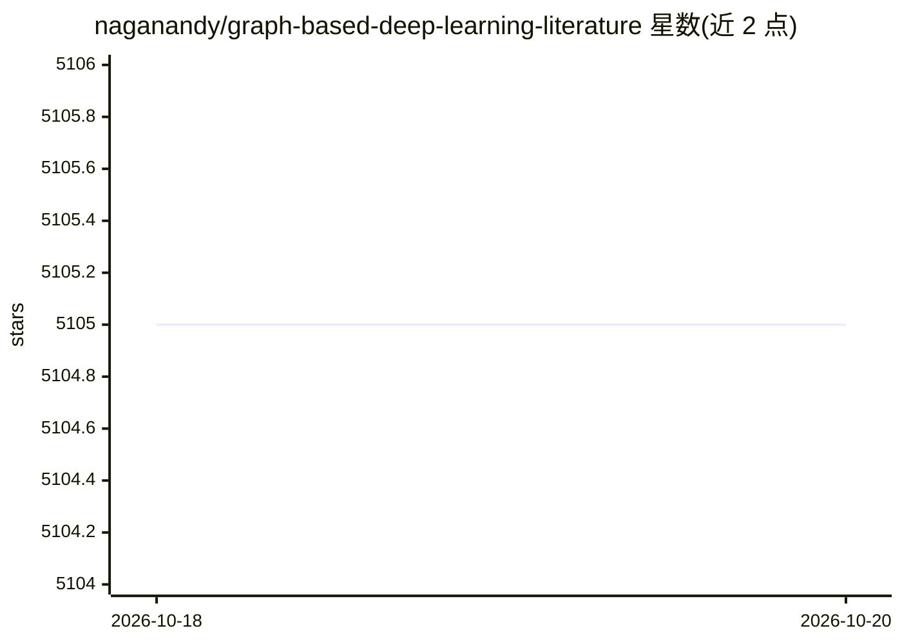

# naganandy/graph-based-deep-learning-literature

⭐ 5,105 · Jupyter Notebook · MIT · 推送 2026-10-19 · [GitHub](https://github.com/naganandy/graph-based-deep-learning-literature) · 个人维护

**图深度学习会议论文链接汇编，覆盖 ML/DM/AI/CV/NLP 会议**

按会议与年份组织的图深度学习文献链接集合：收录 NeurIPS、ICML、ICLR、KDD、AAAI、CVPR、ACL 等会议 2014-2027 年间的图相关论文链接，各会议内按主题类别分组。另含相关研讨会、综述/文献回顾/书籍、软件/库的链接，并单列图神经网络被引最多的 10 篇论文。纯链接汇编，不提供代码或安装方式。

## 筛选速览

| 维度 | 判定 | 备注 |
|---|---|---|
| AI 角色 | `ai-knowledge` | 知识聚合/清单类 |
| 许可风险 | `permissive` | MIT |
| 部署形态 | `None` |  |
| 模型依赖 | — | README 未给出锁定关系 |
| 硬件要求 | — | 无带数字的原话,不猜 |
| 安装摩擦 | `low` | 无编译、无系统依赖或容器化 |
| 成熟度 | — | 结构信号不足 |

## 能力要点

- 按会议与年份（2014-2027）组织的图深度学习论文链接
- 覆盖机器学习、数据挖掘、AI、计算机视觉、计算语言学、LoG 六类会议
- 附带研讨会、综述/书籍、软件库链接
- 列出图神经网络领域 10 篇最高被引论文

## 适用场景

- 查找某会议某年份的图神经网络论文
- 调研图表示学习领域的经典与高被引工作
- 发现相关研讨会、综述与软件库

## 场景标签

`科研工具` `精选清单` · 领域:学习与行业

## 证据(README 行号)

> L1: # Graph-based Deep Learning Literature
> L3: The repository primarily contains links to conference publications in graph-based deep learning.

## 星数曲线

2026-10-18 5,105 → 2026-10-20 5,105（+0）

---
*卡片 v1 · prompt 1.4 · 生成 2026-10-20 · 置信度 high · 依据 README sha `ce765a5471cb` · [字段定义](../../DATASET.md)*
