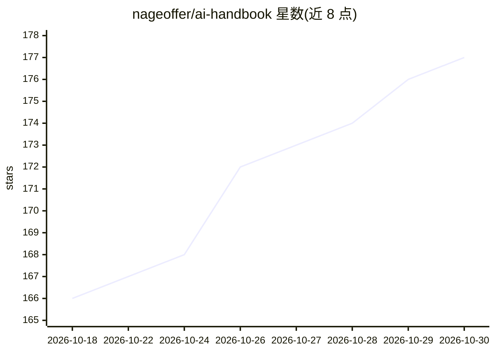

# nageoffer/ai-handbook

⭐ 177 · Apache-2.0 · 推送 2026-07-28 · [GitHub](https://github.com/nageoffer/ai-handbook) · [官网](https://nageoffer.com/ai/) · 组织维护 · 中文 README

**程序员转型 AI 工程师的系统化知识手册与面试题库**

面向希望转型 AI 方向的程序员的开源知识手册：以体系化教程形式覆盖 LLM 基础、RAG 全链路（文档解析、分块、向量检索、评估）、工具调用与 MCP 协议、Agent 架构（ReAct、记忆、规划、多智能体）等内容，部分章节含 Java 手写实战（如纯 Java 最小 ReAct Agent、Spring Boot SSE 流式接口）。另收录来源于牛客、小红书、脉脉等平台的高频 AI Agent 面试题库。项目持续更新中，部分章节尚未完成（标记🔲），以在线文档形式发布。

## 筛选速览

| 维度 | 判定 | 备注 |
|---|---|---|
| AI 角色 | `ai-knowledge` | 知识聚合/清单类 |
| 许可风险 | `permissive` | Apache-2.0 |
| 部署形态 | `None` |  |
| 模型依赖 | — | README 未给出锁定关系 |
| 硬件要求 | — | 无带数字的原话,不猜 |
| 安装摩擦 | `low` | 无编译、无系统依赖或容器化 |
| 成熟度 | `idea` | |

## 能力要点

- RAG 系列教程覆盖从大模型基础到流式通信的 26 个章节
- Agent 系列含 ReAct、记忆管理、规划编排、多智能体等 23 个章节
- AI Agent 高频面试题库，含 Top50 加权排序必刷题
- 含 Java 实战内容：纯 Java 手写 ReAct Agent、Spring Boot SSE 流式接口

## 适用场景

- 程序员系统学习 RAG 与 Agent 知识并规划 AI 工程师转型路线
- 备战 AI 岗位面试，刷高频 Agent/RAG/MCP 面试题
- 查阅 RAG、Agent、MCP 等术语与架构的速查资料

## 场景标签

`教程课程` · 领域:学习与行业

## 证据(README 行号)

> L22: 这个仓库就是为了解决这些问题 —— **一份持续更新的 AI 工程师成长手册**，系统梳理 AI 基础、LLM、RAG、Agent 等核心知识，助你从入门到转型 AI 工程师。
> L38: ### RAG 系列 · 从零构建检索增强生成系统
> L110: 精选 AI Agent 领域高频面试题，覆盖 Agent、RAG、LLM、MCP 等核心方向，数据来源于牛客、小红书、脉脉等多平台。

## 星数曲线

2026-10-18 166 → 2026-10-30 177（+11）

---
*卡片 v1 · prompt 1.4 · 生成 2026-10-22 · 置信度 high · 依据 README sha `7279847a13c4` · [字段定义](../../DATASET.md)*
