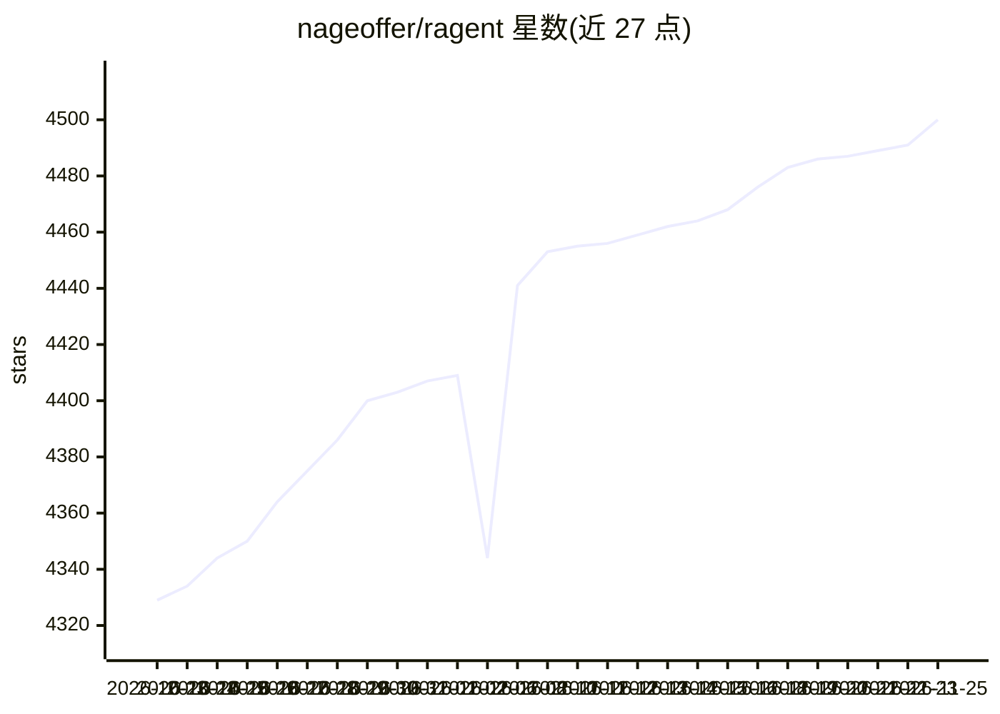

# nageoffer/ragent

⭐ 4,500 · Java · Apache-2.0 · 推送 2026-11-24 · [GitHub](https://github.com/nageoffer/ragent) · [官网](https://nageoffer.com/ragent) · 个人维护 · 中文 README

**Java 后端开发者学习 Agentic RAG 工程实现的开源实战平台**

面向 Java 后端程序员的教学与工程参考项目：提供一套前后端分离的 Agentic RAG 应用，覆盖文档解析、混合检索（向量/关键词/知识图谱/联网）、意图识别、问题重写、会话记忆、MCP 工具调用与 ReAct Agent 执行，后端分 7 个 Maven 模块，前端为 React 控制台。v1 为 Workflow 固定编排链路，v2 为模型自主决策的 Agentic 架构，两套并存。README 明确定位为简历/面试导向的学习项目，配套官网文档与在线体验入口，本地部署步骤在外部快速启动文档中。

## 筛选速览

| 维度 | 判定 | 备注 |
|---|---|---|
| AI 角色 | `ai-native` | 本体是模型或模型工具 |
| 许可风险 | `permissive` | Apache-2.0 |
| 部署形态 | `None` |  |
| 模型依赖 | — | README 未给出锁定关系 |
| 硬件要求 | — | 无带数字的原话,不猜 |
| 安装摩擦 | `low` | 无编译、无系统依赖或容器化 |
| 成熟度 | — | 结构信号不足 |

## 能力要点

- 混合检索：向量、关键词、知识图谱、联网并行召回，RRF 融合与 Rerank
- v1 Workflow 与 v2 ReAct Agent 两套链路并存，MCP 工具发现与写操作人工确认
- 模型档位、首包探测、熔断降级与 Redis 公平排队等流量保护机制
- 管理后台覆盖知识库、意图树、入库任务、Trace 与 Langfuse 可观测接入

## 适用场景

- 作为 Java 技术栈学习 RAG 与 Agent 工程落地的实战项目
- 将完整 AI 项目经验整理进校招/社招简历
- 参考其检索、模型容错与上下文管理等设计做二次开发

## 场景标签

`RAG` `教程课程` · 领域:知识与检索

## 证据(README 行号)

> L16: Ragent 是一个面向 Agentic RAG 演进的生产级 Java AI 应用平台，覆盖从文档入库到智能问答的完整链路。
> L89: 基于这些问题，我决定做一个 Agentic RAG 实战项目，名字叫 **Ragent**。
> L321: - **前后端完整项目经验**：后端 Spring Boot 4 + 前端 React 18，从 API 设计到页面交互，完整的全栈项目经历。

## 星数曲线

2026-10-23 4,329 → 2026-11-25 4,500（+171）

---
*卡片 v1 · prompt 1.4 · 生成 2026-11-22 · 置信度 high · 依据 README sha `b4e5f440ca22` · [字段定义](../../DATASET.md)*
