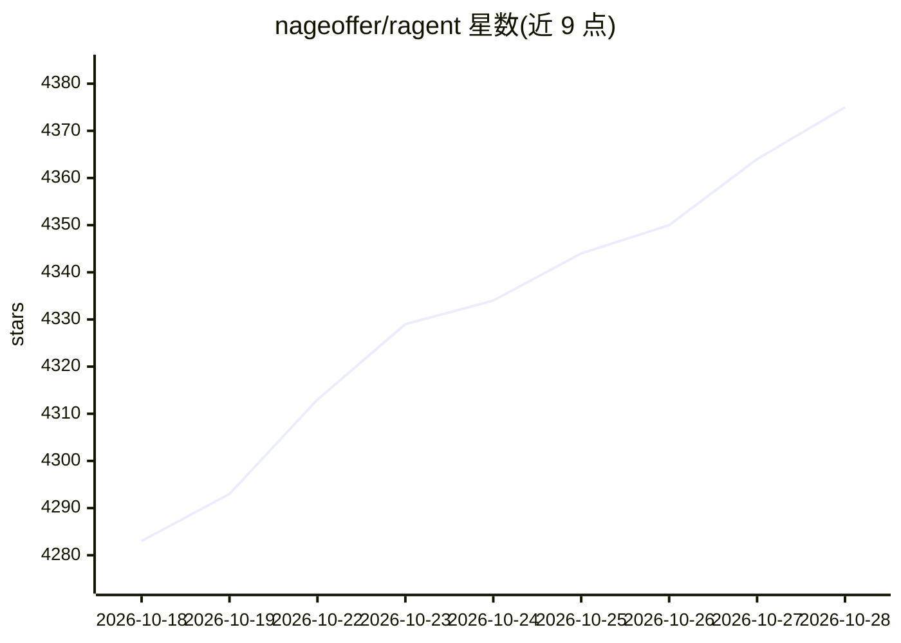

# nageoffer/ragent

⭐ 4,386 · Java · Apache-2.0 · 推送 2026-10-25 · [GitHub](https://github.com/nageoffer/ragent) · [官网](https://nageoffer.com/ragent) · 组织维护 · 中文 README

**面向 Java 后端的 Agentic RAG 生产级开源工程参考项目**

Ragent 是基于 Java（Spring Boot 4 后端 + React 18 前端）的 Agentic RAG 应用平台，覆盖文档入库 Pipeline、向量/关键词/知识图谱/联网多路召回与 RRF 融合、问题重写与树形意图识别、ReAct Agent 执行引擎、MCP 工具发现与调用、会话记忆与摘要、模型档位与熔断降级、Redis 公平排队、Langfuse 追踪及管理后台。同时作为学习项目，面向想转型 AI 方向的 Java 后端开发者，定位为源码级工程参考，提供在线体验与本地搭建文档。

## 筛选速览

| 维度 | 判定 | 备注 |
|---|---|---|
| AI 角色 | `ai-native` | 本体是模型或模型工具 |
| 许可风险 | `permissive` | Apache-2.0 |
| 部署形态 | `None` |  |
| 模型依赖 | — | README 未给出锁定关系 |
| 硬件要求 | — | 无带数字的原话,不猜 |
| 安装摩擦 | `low` | 无编译、无系统依赖或容器化 |
| 成熟度 | — | 结构信号不足 |

## 能力要点

- v1 Workflow 编排与 v2 ReAct Agentic 双链路并存
- 向量/关键词/知识图谱/联网四路召回，RRF 融合与 Rerank
- MCP Java SDK 工具服务与写操作人工确认
- 模型档位、首包探测、三态熔断与 Redis 公平排队等生产级机制

## 适用场景

- 作为 Java 技术栈的 Agentic RAG 源码级工程参考进行二次开发
- 后端开发者学习 RAG/Agent/MCP 全链路工程实现
- 搭建带知识库管理、Trace 与管理后台的企业问答系统

## 场景标签

`RAG` `教程课程` · 领域:知识与检索

## 证据(README 行号)

> L16: Ragent 是一个面向 Agentic RAG 演进的生产级 Java AI 应用平台，覆盖从文档入库到智能问答的完整链路。
> L18: - **混合检索**：向量、关键词、知识图谱、联网搜索并行召回，支持去重、RRF 融合与 Rerank。
> L20: - **模型与工具**：支持模型档位、首包探测、熔断降级，以及 AgentScope 的 MCP 工具发现与调用。

## 星数曲线

2026-10-18 4,283 → 2026-10-28 4,375（+92）

---
*卡片 v1 · prompt 1.4 · 生成 2026-10-20 · 置信度 high · 依据 README sha `da3a0ac60332` · [字段定义](../../DATASET.md)*
