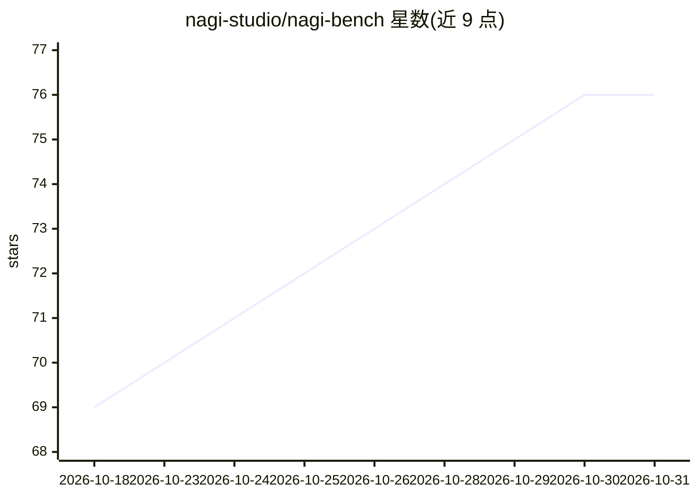

# nagi-studio/nagi-bench

⭐ 76 · HTML · MIT · 推送 2026-10-23 · [GitHub](https://github.com/nagi-studio/nagi-bench) · [官网](http://bench.nagi.fun/) · 组织维护 · 中文 README

**LLM Agent 一次生成能力测评案例集与社区盲评榜单**

NAGI STUDIO 维护的 LLM 测评数据仓库：以「模型 × Harness × 思考配额」组合为测评单位（称为 Agent），对固定提示词逐字一次生成可运行作品（HTML/SVG/React 等），并排展示供社区 Arena 匿名盲评，按 Bradley-Terry 评分生成榜单。已覆盖 Anthropic、OpenAI、Google、DeepSeek 等 20 余家厂商的上百个组合。贡献只需添加产出文件与 JSON 登记文件，CI 自动校验；站点与投票后端在私有仓库，本仓库是数据源。

## 筛选速览

| 维度 | 判定 | 备注 |
|---|---|---|
| AI 角色 | `ai-knowledge` | 知识聚合/清单类 |
| 许可风险 | `permissive` | MIT |
| 部署形态 | `None` |  |
| 模型依赖 | — | README 未给出锁定关系 |
| 硬件要求 | — | 无带数字的原话,不猜 |
| 安装摩擦 | `low` | 无编译、无系统依赖或容器化 |
| 成熟度 | — | 结构信号不足 |

## 能力要点

- 测评单位为 Agent = 模型 × Harness × 思考配额，换任一即记为不同条目
- Arena 匿名盲评 + Bradley-Terry 社区榜单，带 Turnstile 防刷
- 6 个固定案例（体素世界、SVG 绘画、3D 射击等），提示词逐字使用、一次生成
- 贡献免代码：加产出文件 + models/*.json 登记，bun 脚本本地自检

## 适用场景

- 对比不同模型与 Harness 在同一提示词下的实际产出质量
- 参与匿名盲评投票并查看社区榜单
- 为自己的模型/Harness 组合提交产出补充空位

## 场景标签

`模型评测` · 领域:评测与运维

## 证据(README 行号)

> L6: NAGI STUDIO 的 LLM 测评案例集：把「模型 × Harness × 思考配额」组合放进同一道题，并排对比它们交出的可运行作品，再交给大家匿名盲评。
> L70: > 模型只是权重，套上运行环境才成为一个能干活的智能体（Agent）。**本仓库的测评单位就是一个 Agent。**
> L79: 已经有上百个「模型 × Harness × 思考配额」组合跑过这些案例，覆盖 Anthropic、OpenAI、Google、DeepSeek、xAI、Moonshot、Zhipu、Alibaba 等厂商。逐个看作品请去 benc

## 星数曲线

2026-10-18 69 → 2026-10-31 76（+7）

---
*卡片 v1 · prompt 1.4 · 生成 2026-10-24 · 置信度 high · 依据 README sha `aa7ceee3f0ed` · [字段定义](../../DATASET.md)*
