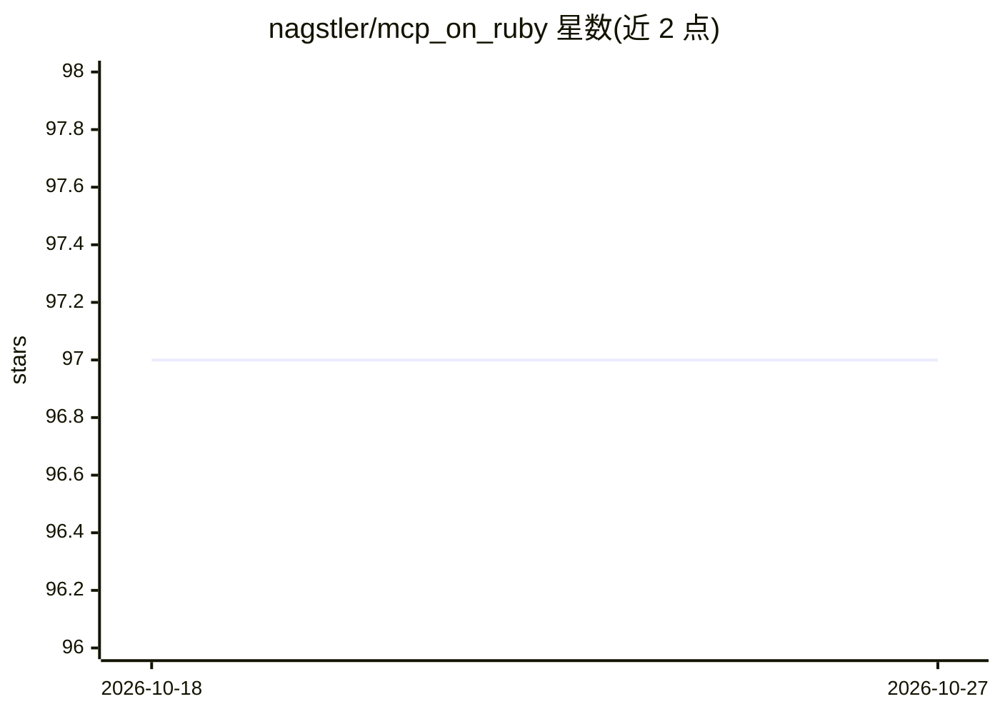

# nagstler/mcp_on_ruby

⭐ 97 · Ruby · MIT · 推送 2026-06-05 · [GitHub](https://github.com/nagstler/mcp_on_ruby) · 个人维护

**Rails 应用的 MCP 服务器实现：以 Rails 方式暴露工具与资源给 AI 客户端**

Model Context Protocol 的 Ruby/Rails 实现，以 Ruby gem 形式提供。开发者通过 Rails 生成器安装后，可用 DSL 定义带 JSON Schema 校验的工具（Tools）和带 URI 模板的资源（Resources），将 Rails 应用暴露为 AI 可访问接口，挂载于 /mcp 路径。内置认证、限流、DNS rebinding 防护与 CORS 等安全机制，SSE 实时传输为规划中功能。要求 Ruby 2.7+ 与 Rails 6.0+，生产依赖仅 json-schema、rack、webrick。提供 Claude Desktop 接入指南与 RSpec 测试支持。

## 筛选速览

| 维度 | 判定 | 备注 |
|---|---|---|
| AI 角色 | `ai-ecosystem` | LLM/agent 周边工具 |
| 许可风险 | `permissive` | MIT |
| 部署形态 | `None` |  |
| 模型依赖 | — | README 未给出锁定关系 |
| 硬件要求 | — | 无带数字的原话,不猜 |
| 安装摩擦 | `low` | 无编译、无系统依赖或容器化 |
| 成熟度 | — | 结构信号不足 |

## 能力要点

- Rails 集成：生成器、自动加载、中间件、Railtie
- 工具系统带 JSON Schema 校验，资源系统支持 URI 模板
- 认证、限流、DNS rebinding 防护、CORS 等安全机制
- 与 Claude Desktop 等 MCP 客户端对接的接入指南

## 适用场景

- 把现有 Rails 应用的功能封装成 AI agent 可调用的 MCP 工具
- 向 Claude Desktop 等客户端暴露 Rails 应用的数据资源
- 在企业 Rails 服务中集中管理 AI 访问接口的认证与限流

## 场景标签

`Agent 框架` · 领域:Agent 开发

## 证据(README 行号)

> L7: **Model Context Protocol (MCP) server for Rails applications**
> L9: Expose your Rails app as an AI accessible interface — define tools and resources the Rails way.
> L17: 🛠️ **Tools System** - Callable functions with JSON Schema validation

## 星数曲线

2026-10-18 97 → 2026-10-27 97（+0）

---
*卡片 v1 · prompt 1.4 · 生成 2026-10-23 · 置信度 high · 依据 README sha `1ead2252a06f` · [字段定义](../../DATASET.md)*
