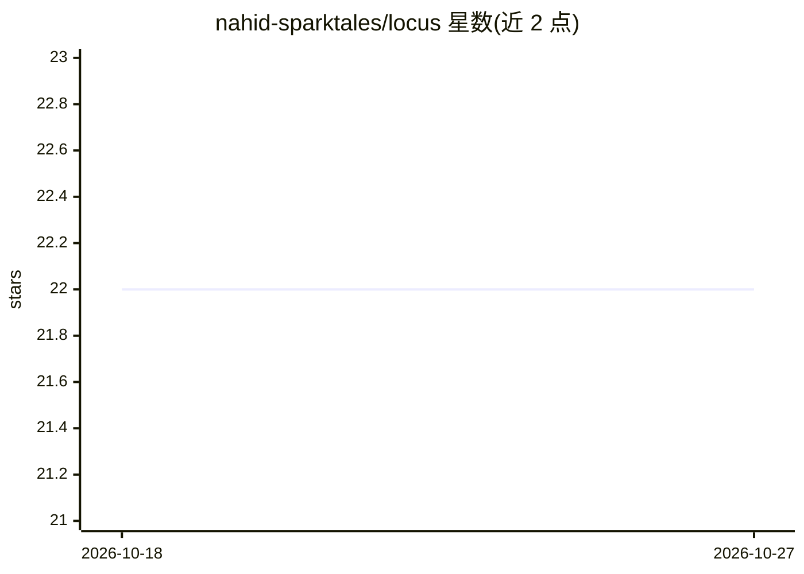

# nahid-sparktales/locus

⭐ 22 · Swift · Apache-2.0 · 推送 2026-10-22 · [GitHub](https://github.com/nahid-sparktales/locus) · [官网](https://locushost.co) · 组织维护

**macOS 原生 AI 工作区：本地/托管模型、代理、浏览器与终端合一**

SwiftUI 编写的 macOS 桌面应用，把对话、项目文件、终端、浏览器标签、计划与定期代理整合在一个工作区中。默认使用本地 Ollama，也支持 ChatGPT 订划、OpenAI、Claude、Kimi 或 OpenAI 兼容端点（API key），不会静默切换到付费账户。聊天记录、运行记录与记忆存储在本地，凭据存于 Keychain。另有含钱包功能的 LocusX 版本；两者均为同一公证下载包。要求 Apple Silicon 且 macOS 14 以上，可从源码用 Xcode 26 构建。

## 筛选速览

| 维度 | 判定 | 备注 |
|---|---|---|
| AI 角色 | `ai-native` | 本体是模型或模型工具 |
| 许可风险 | `permissive` | Apache-2.0 |
| 部署形态 | `library` | 以包/库形式分发 |
| 模型依赖 | local-ok | 支持本地模型 |
| 硬件要求 | — | 无带数字的原话,不猜 |
| 安装摩擦 | `medium` | 含编译或系统依赖之一 |
| 成熟度 | — | 结构信号不足 |

## 能力要点

- 对话、终端、内置浏览器与项目文件并置的原生工作区
- 默认本地 Ollama，可选 ChatGPT 计划/OpenAI/Claude/Kimi/兼容端点
- 定期代理、任务胶囊、代理团队与目标续跑机制
- 本地存储 + Keychain 凭据 + AES-256-GCM 加密记忆

## 适用场景

- 在 Mac 上以本地模型为主进行带文件与终端的项目工作
- 让代理定时或按事件触发执行任务并查看运行历史
- 通过手机伴侣应用经 LAN/Tailscale 继续会话

## 场景标签

`AI 助手` `多智能体` · 领域:Agent 开发

## 证据(README 行号)

> L10: Locus combines conversations, project files, a terminal, browser tabs, plans,
> L11: and recurring agents in a SwiftUI app. Use local Ollama, a ChatGPT plan, or your
> L52: - **Choose your models.** Use Ollama, ChatGPT-plan access, OpenAI, Claude,

## 星数曲线

2026-10-18 22 → 2026-10-27 22（+0）

---
*卡片 v1 · prompt 1.4 · 生成 2026-10-27 · 置信度 mid · 依据 README sha `537db92782e6` · [字段定义](../../DATASET.md)*
