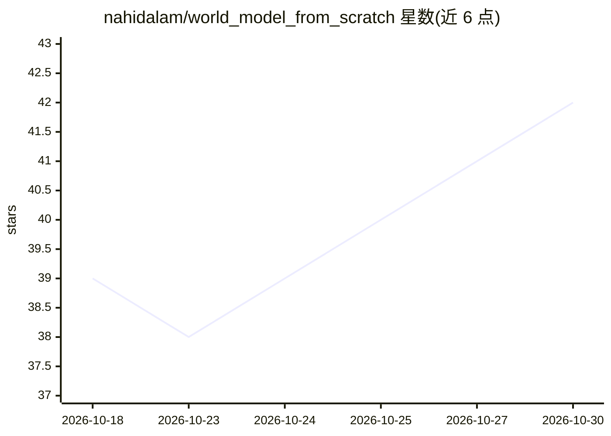

# nahidalam/world_model_from_scratch

⭐ 42 · Jupyter Notebook · 推送 2026-10-29 · [GitHub](https://github.com/nahidalam/world_model_from_scratch) · [官网](https://world-models-from-scratch.gitbook.io) · 个人维护

**《World Models from Scratch》书籍配套代码库**

一本讲解世界模型（world models）的实践书籍的代码仓库，内容覆盖理解、运行预训练模型、评测、从零构建、预训练、微调与推理优化等章节（第 5-9 章标注 coming soon）。可复用代码位于 src/world_models/，测试在 tests/，可交互演示在 interactive/；安装方式为 pip install -r requirements.txt 与 pip install -e .，各章节可能有额外 GPU 或系统要求。

## 筛选速览

| 维度 | 判定 | 备注 |
|---|---|---|
| AI 角色 | `ai-knowledge` | 知识聚合/清单类 |
| 许可风险 | `none` | — |
| 部署形态 | `library` | 以包/库形式分发 |
| 模型依赖 | — | README 未给出锁定关系 |
| 硬件要求 | — | 无带数字的原话,不猜 |
| 安装摩擦 | `low` | 无编译、无系统依赖或容器化 |
| 成熟度 | — | 结构信号不足 |

## 能力要点

- 按章节组织的从零构建世界模型教程与代码
- 提供可复用代码模块、测试与自包含交互演示
- 涵盖预训练、微调、推理时优化与蒸馏等主题

## 适用场景

- 跟着书籍章节学习世界模型的训练与评测
- 复用 src/world_models/ 中的代码做实验
- 运行 interactive/ 中的演示探索世界模型行为

## 场景标签

`教程课程` `模型训练` · 领域:学习与行业

## 证据(README 行号)

> L9: This book is a hands-on guide for builders who want to understand, train, evaluate, customize, and deploy world mode
> L26: Reusable code is in `src/world_models/`, tests in `tests/`, self-contained explorable demos in `interactive/`. Inst

## 星数曲线

2026-10-18 39 → 2026-10-30 42（+3）

---
*卡片 v1 · prompt 1.4 · 生成 2026-10-25 · 置信度 high · 依据 README sha `50cc3196f86f` · [字段定义](../../DATASET.md)*
