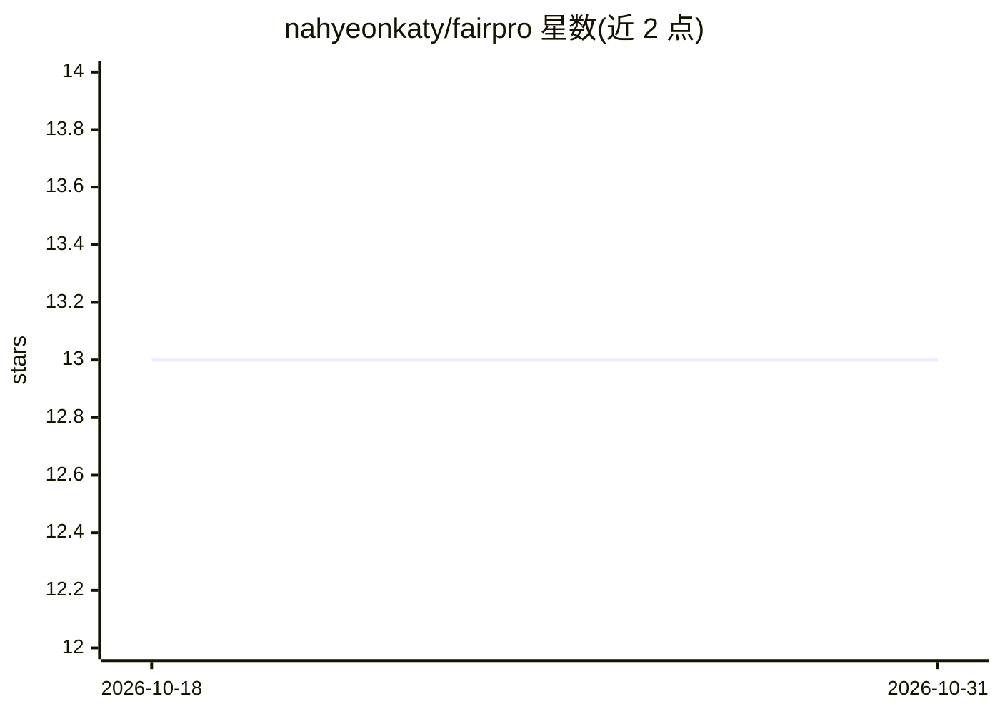

# nahyeonkaty/fairpro

⭐ 13 · Python · MIT · 推送 2026-04-01 · [GitHub](https://github.com/nahyeonkaty/fairpro) · [官网](https://fairpro-t2i.github.io) · 组织维护

**免训练的公平性元提示框架：自审生成公平感知系统提示（T2I 偏见评测）**

arXiv'25 论文官方代码库：发现 LLM-based T2I 模型产生更多社会偏见图像，且系统提示是偏见的主要驱动因素。提供 1,024 条提示（256 职业×4 级语言复杂度）的人口统计偏见基准，以及 FairPro——无需训练的元提示框架，让 LLM 在测试时自审并构建公平感知的系统提示。默认用 Qwen2.5-7B-Instruct 生成提示，Qwen-Image 生成对比图像，GenEval 评测。需 CUDA GPU 与 PyTorch 2.0+，MIT 许可。

## 筛选速览

| 维度 | 判定 | 备注 |
|---|---|---|
| AI 角色 | `ai-ecosystem` | LLM/agent 周边工具 |
| 许可风险 | `permissive` | MIT |
| 部署形态 | `library` | 以包/库形式分发 |
| 模型依赖 | — | README 未给出锁定关系 |
| 硬件要求 | — | 无带数字的原话,不猜 |
| 安装摩擦 | `medium` | 含编译或系统依赖之一 |
| 成熟度 | — | 结构信号不足 |

## 能力要点

- 1,024 条提示基准，覆盖 4 级语言复杂度与 256 种职业
- FairPro 免训练元提示框架，测试时自审构建公平感知系统提示
- 支持默认与 FairPro 系统提示的图像生成对比流程
- 数据集同步发布于 Hugging Face

## 适用场景

- 评测 T2I 模型的人口统计偏见（性别/年龄/族裔/体型）
- 生成并应用公平感知系统提示以缓解 T2I 偏见
- 研究系统提示对生成图像偏见的影响

## 场景标签

`模型评测` `图像生成` `提示工程` · 领域:Agent 开发

## 证据(README 行号)

> L14: - We find that LLM-based T2I models produce markedly more socially biased images than non-LLM-based models.
> L17: - We propose FairPro, a training-free meta-prompting framework that enables LLMs to self-audit and construct fairne
> L21: We introduce a comprehensive benchmark for evaluating demographic bias in T2I models, consisting of **1,024 prompts

## 星数曲线

2026-10-18 13 → 2026-10-31 13（+0）

---
*卡片 v1 · prompt 1.4 · 生成 2026-10-31 · 置信度 high · 依据 README sha `d891720ec967` · [字段定义](../../DATASET.md)*
