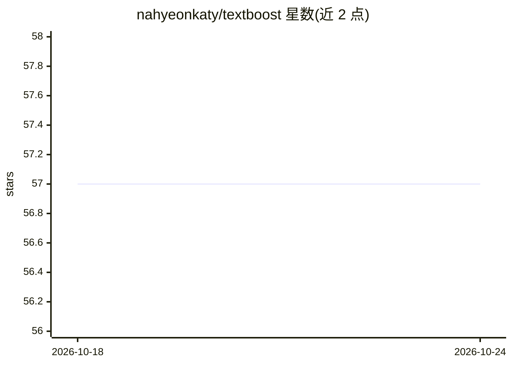

# nahyeonkaty/textboost

⭐ 57 · Jupyter Notebook · MIT · 推送 2026-05-18 · [GitHub](https://github.com/nahyeonkaty/textboost) · [官网](https://textboost.github.io) · 个人维护

**单样本个性化文生图方法：仅微调文本编码器**

TMLR 论文官方代码库。提出 TextBoost 单样本个性化方法：只选择性微调文本编码器，配合因果保持适配机制与轻量适配器（在跨注意力层交互前局部精炼文本嵌入），降低存储与计算开销。提供训练与评测统一脚本，支持 SD2.1、SDXL、SANA 架构，自动下载数据集、迭代实例、微调并生成图像。测试环境为 Python 3.12 与 NVIDIA A6000 GPU，需从源码 pip install -e 安装。

## 筛选速览

| 维度 | 判定 | 备注 |
|---|---|---|
| AI 角色 | `ai-native` | 本体是模型或模型工具 |
| 许可风险 | `permissive` | MIT |
| 部署形态 | `library` | 以包/库形式分发 |
| 模型依赖 | — | README 未给出锁定关系 |
| 硬件要求 | — | 无带数字的原话,不猜 |
| 安装摩擦 | `low` | 无编译、无系统依赖或容器化 |
| 成熟度 | — | 结构信号不足 |

## 能力要点

- 仅微调文本编码器的单样本个性化方案
- 轻量适配器在跨注意力交互前精炼文本嵌入
- 统一脚本支持 SD2.1 / SDXL / SANA 训练与评测
- 提供数据集自动下载脚本（DreamBooth、StyleDrop）

## 适用场景

- 用单张主题图像个性化文生图模型
- 在资源受限环境下做低成本文生图微调实验
- 复现 TMLR 论文的训练与评测流程

## 场景标签

`图像生成` `微调` · 领域:内容生成

## 证据(README 行号)

> L10: Abstract: *In this paper, we introduce TextBoost, an efficient one-shot personalization approach for text-to-image 
> L42: We provide unified scripts that handle both the training and evaluation loops. To run the full pipeline for Stable 

## 星数曲线

2026-10-18 57 → 2026-10-24 57（+0）

---
*卡片 v1 · prompt 1.4 · 生成 2026-10-24 · 置信度 high · 依据 README sha `cfb713214d9d` · [字段定义](../../DATASET.md)*
