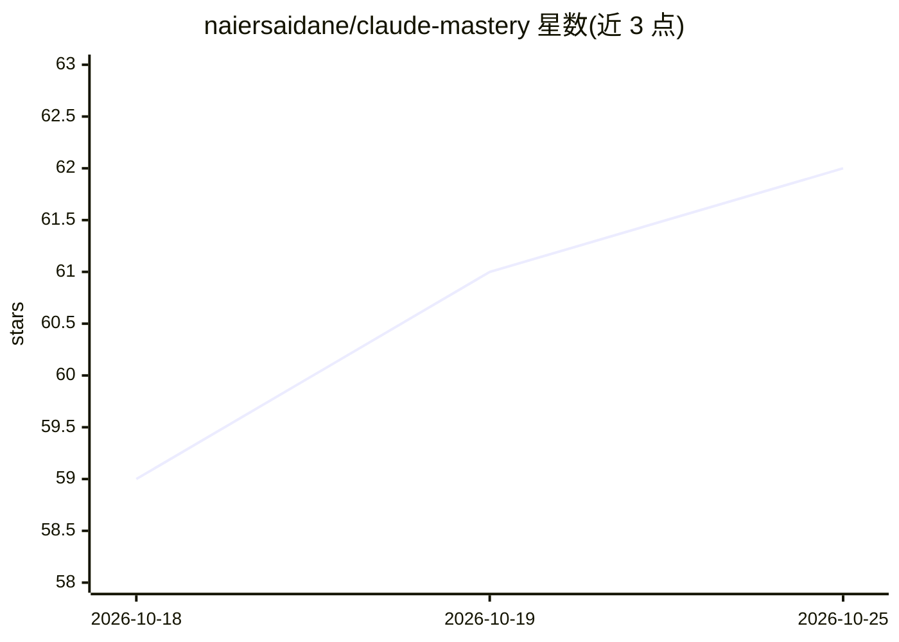

# naiersaidane/claude-mastery

⭐ 62 · Python · MIT · 推送 2026-07-21 · [GitHub](https://github.com/naiersaidane/claude-mastery) · 组织维护

**面向 Claude Code 的 8 个开发流程技能（问答/规划/设计/交付）**

法国培训机构 L'Accélérateur IA 的 Claude Mastery 课程配套技能包：将课程方法转化为 8 个 Claude Code skills，通过 npx skills add 一键安装。/interroge 逐问澄清需求、/cadre 生成 PRD、/planifie 拆解为可交付阶段、/design 产出设计系统文档、/investigue 四阶段排查 bug、/illustre 生成 Excalidraw 图、/branche 与 /livre 负责 Git 分支与 PR 交付。兼容 Claude Code 及任何可读取 skills 的 agent，运行需 Node。

## 筛选速览

| 维度 | 判定 | 备注 |
|---|---|---|
| AI 角色 | `ai-ecosystem` | LLM/agent 周边工具 |
| 许可风险 | `permissive` | MIT |
| 部署形态 | `library` | 以包/库形式分发 |
| 模型依赖 | — | README 未给出锁定关系 |
| 硬件要求 | — | 无带数字的原话,不猜 |
| 安装摩擦 | `low` | 无编译、无系统依赖或容器化 |
| 成熟度 | — | 结构信号不足 |

## 能力要点

- 8 个命令覆盖需求澄清→规划→设计→调试→交付全流程
- /cadre 输出 8 节 PRD，/planifie 按垂直切片拆阶段
- /investigue 四阶段（定位/假设/插桩/最小修复）排查 bug
- /illustre 生成 Excalidraw 图（PNG 2x + SVG）

## 适用场景

- 用 Claude Code 做项目时先澄清需求再生成 PRD 与计划
- 让 agent 按固定流程排查 bug 而非盲改
- 统一团队的 Git 分支与 PR 交付流程

## 场景标签

`提示工程` · 领域:Agent 开发

## 证据(README 行号)

> L3: **8 skills Claude Code pour passer d'une idée à un produit livré.** La méthode enseignée dans la formation Claude Ma
> L13: La commande installe les 8 skills et les rend disponibles pour ton agent (Claude Code et tout agent qui lit les ski

## 星数曲线

2026-10-18 59 → 2026-10-25 62（+3）

---
*卡片 v1 · prompt 1.4 · 生成 2026-10-24 · 置信度 high · 依据 README sha `899cf2912b6c` · [字段定义](../../DATASET.md)*
