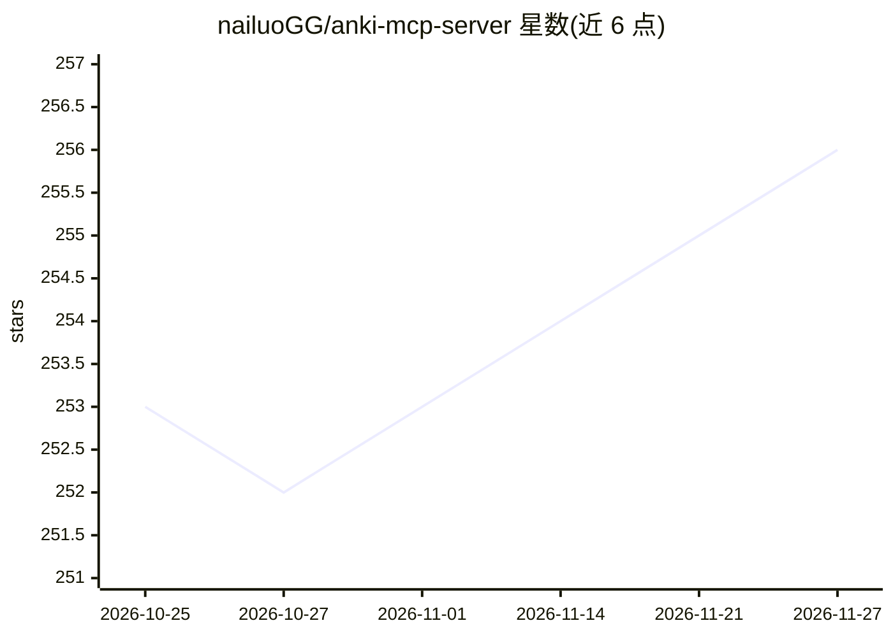

# nailuoGG/anki-mcp-server

⭐ 256 · TypeScript · 推送 2026-11-21 · [GitHub](https://github.com/nailuoGG/anki-mcp-server) · 个人维护

**让 LLM 通过 MCP 操作 Anki 记忆卡片库的服务器**

一个 MCP 服务器，通过 AnkiConnect 插件使 LLM 客户端能调用 16 个 Anki 工具：卡组/标签/笔记类型的列出与创建、笔记的增删改查与搜索、AnkiWeb 同步（需显式确认）。提供 anki:// 资源端点暴露卡组、标签与笔记类型结构，支持自定义端口，兼容 stdio 协议的 MCP 客户端，并为 Claude Code 提供技能安装入口。前置条件为本机安装 Anki 与 AnkiConnect 及 Node.js 20.11+。

## 筛选速览

| 维度 | 判定 | 备注 |
|---|---|---|
| AI 角色 | `ai-ecosystem` | LLM/agent 周边工具 |
| 许可风险 | `none` | — |
| 部署形态 | `library` | 以包/库形式分发 |
| 模型依赖 | — | README 未给出锁定关系 |
| 硬件要求 | — | 无带数字的原话,不猜 |
| 安装摩擦 | `low` | 无编译、无系统依赖或容器化 |
| 成熟度 | — | 结构信号不足 |

## 能力要点

- 16 个 anki_* 工具覆盖笔记增删改查、搜索与同步
- anki:// 资源端点暴露卡组、标签与笔记类型结构
- AnkiWeb 同步需 confirm:true，防止合并/覆盖误操作
- npx 一行运行，支持 Claude Code 技能安装

## 适用场景

- 让 AI 助手批量创建 Anki 卡片与卡组
- 通过对话搜索、更新、删除已有笔记
- 为 Claude Code 安装技能以自动化记忆卡片工作流

## 场景标签

`知识库管理` · 领域:知识与检索

## 证据(README 行号)

> L3: A Model Context Protocol (MCP) server that enables LLMs to interact with Anki flashcard software through AnkiConnect
> L11: - `anki_check_connection` - Check whether AnkiConnect is reachable

## 星数曲线

2026-10-25 253 → 2026-11-27 256（+3）

---
*卡片 v1 · prompt 1.4 · 生成 2026-11-25 · 置信度 high · 依据 README sha `47d6de99e7f6` · [字段定义](../../DATASET.md)*
