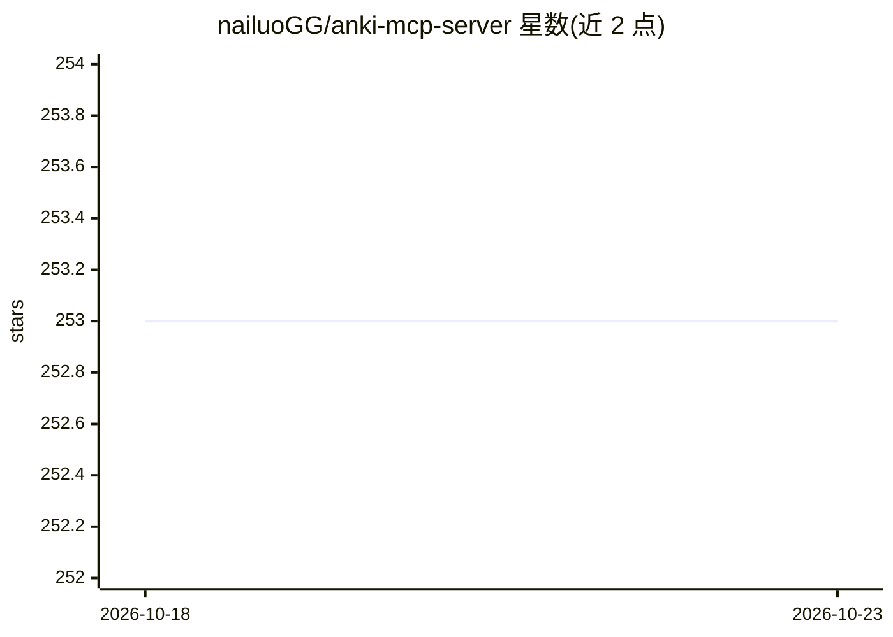

# nailuoGG/anki-mcp-server

⭐ 253 · TypeScript · 推送 2026-10-22 · [GitHub](https://github.com/nailuoGG/anki-mcp-server) · 个人维护

**让 LLM 通过 MCP 操作 Anki 记忆卡片的服务器**

基于 Node.js 的 Model Context Protocol 服务器，通过 AnkiConnect 插件让 Claude Desktop、Cline 等 LLM 客户端操作 Anki：提供 17 个 anki_* 前缀工具（建卡组、批量建卡片、搜索、更新删除笔记、笔记类型管理、AnkiWeb 同步等）及 5 类 anki:// 资源；保留旧版无前缀工具名兼容既有客户端。前置要求为系统安装 Anki、AnkiConnect 插件与 Node.js 20.11+；支持 .mcpb 桌面扩展安装与 npx 运行，附带 MCP 评测资产与单元测试（mock AnkiConnect）。限制：.mcpb 版本作为 stdio MCP server 会输出 Electron 元数据破坏协议，需改用 npx 版本。

## 筛选速览

| 维度 | 判定 | 备注 |
|---|---|---|
| AI 角色 | `ai-ecosystem` | LLM/agent 周边工具 |
| 许可风险 | `none` | — |
| 部署形态 | `library` | 以包/库形式分发 |
| 模型依赖 | locked-api |  |
| 硬件要求 | — | 无带数字的原话,不猜 |
| 安装摩擦 | `low` | 无编译、无系统依赖或容器化 |
| 成熟度 | — | 结构信号不足 |

## 能力要点

- 17 个 anki_* 工具覆盖牌组/笔记/标签/笔记类型/同步操作
- 提供 Claude Desktop 扩展(.mcpb)、Cline 配置与 Claude Code Agent Skill 三种接入方式
- 通过 --port 参数支持自定义 AnkiConnect 端口
- 附带 mock 单元测试与 evals/ 只读评测资产

## 适用场景

- 让 Claude 或 Cline 用自然语言批量创建/管理 Anki 卡片
- 通过对话搜索、更新、删除 Anki 笔记并添加标签
- 让 agent 自动整理牌组结构并触发 AnkiWeb 同步

## 场景标签

`知识库管理` · 领域:知识与检索

## 证据(README 行号)

> L3: A Model Context Protocol (MCP) server that enables LLMs to interact with Anki flashcard software through AnkiConnect
> L61: Add the server to your claude_desktop_config.json:

## 星数曲线

2026-10-18 253 → 2026-10-23 253（+0）

---
*卡片 v1 · prompt 1.4 · 生成 2026-10-22 · 置信度 high · 依据 README sha `75c806e3bbee` · [字段定义](../../DATASET.md)*
