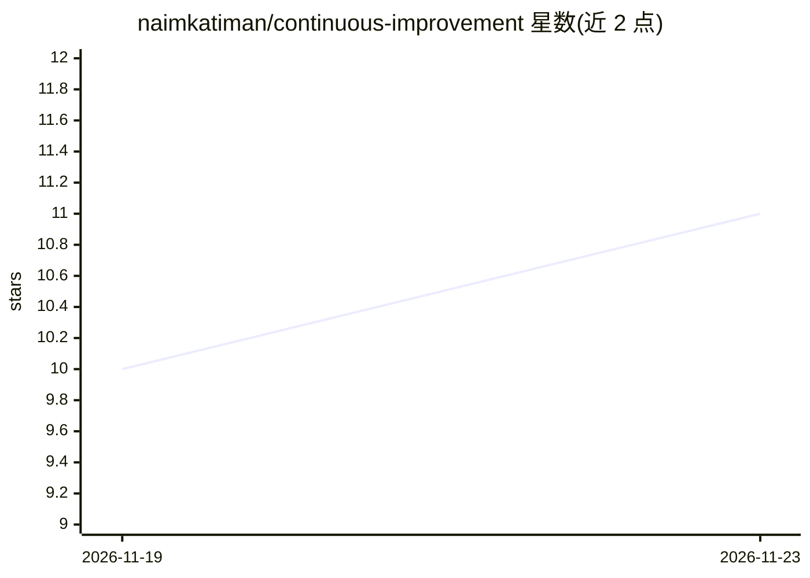

# naimkatiman/continuous-improvement

⭐ 11 · JavaScript · MIT · 推送 2026-11-22 · [GitHub](https://github.com/naimkatiman/continuous-improvement) · [官网](https://continuous-improvement.dev) · 个人维护

**给 Claude Code 加纪律与跨会话记忆的插件**

一个 Claude Code 插件，通过三层机制让编码 agent 每次会话保留经验：PreToolUse 运行时钩子 gateguard 在调查事实提交前物理拦截 Edit/Write/破坏性 Bash；技能集强制规划、TDD 与六阶段验证流程；/seven-laws 反思与 Mulahazah 引擎把观察沉淀为 instinct，recall-briefing 钩子在相关提示出现时回放历史修复。初学者两条命令安装无需 npm；进阶安装提供 19 个 MCP 工具。限制：门禁在 agent 声明事实后属荣誉系统，状态文件可被删除。

## 筛选速览

| 维度 | 判定 | 备注 |
|---|---|---|
| AI 角色 | `ai-ecosystem` | LLM/agent 周边工具 |
| 许可风险 | `permissive` | MIT |
| 部署形态 | `library` | 以包/库形式分发 |
| 模型依赖 | locked-api |  |
| 硬件要求 | — | 无带数字的原话,不猜 |
| 安装摩擦 | `low` | 无编译、无系统依赖或容器化 |
| 成熟度 | — | 结构信号不足 |

## 能力要点

- gateguard 运行时钩子在未完成事实调查前物理拦截 Edit/Write/破坏性 Bash
- /seven-laws 反思与 Mulahazah 引擎将观察沉淀为跨会话 instinct 记忆
- goal-drift-stop 钩子在 Stop 时按既定 Goal 评分并警告漂移会话
- 进阶安装提供 19 个 MCP 工具与 recall-briefing 记忆回放钩子

## 适用场景

- 让 Claude Code 在改代码前先调查仓库已有实现，避免盲改多文件
- 阻止 agent 在未运行测试的情况下宣称任务完成
- 把上一次会话的修复教训带入下一次相关任务

## 场景标签

`编码 Agent` `Agent 记忆` · 领域:Agent 开发

## 证据(README 行号)

> L7:  The 7 Laws of AI Agent Discipline — runtime hooks, instinct memory, and skills that compound what it learns.
> L30: > **What this is *not*:** a prompt template, a `CLAUDE.md`, or a vibes-based reminder. It is a runtime hook (`hooks
> L34: Claude Code is powerful but leaves intelligence on the table: it edits before reading, guesses instead of checking,

## 星数曲线

2026-11-19 10 → 2026-11-23 11（+1）

---
*卡片 v1 · prompt 1.4 · 生成 2026-11-19 · 置信度 high · 依据 README sha `0522b4cc4ac7` · [字段定义](../../DATASET.md)*
