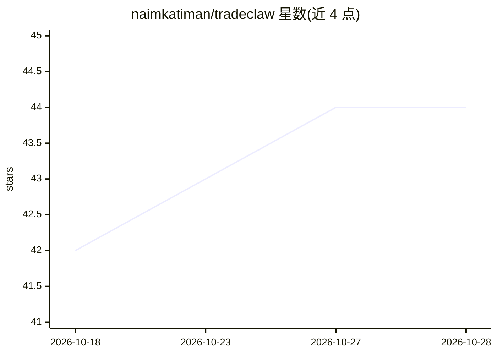

# naimkatiman/tradeclaw

⭐ 44 · TypeScript · MIT · 推送 2026-10-28 · [GitHub](https://github.com/naimkatiman/tradeclaw) · [官网](https://tradeclaw.win) · 个人维护 · 中文 README

**自托管的加密交易信号研究终端：生成信号并公开可审计账本**

Next.js + PostgreSQL 单仓应用，内嵌技术指标引擎（RSI/MACD/EMA/BB/Stoch/ADX/Vol），在 API 请求副作用中生成 BUY/SELL 信号并写入 PostgreSQL signal_history 账本，提供公开战绩页、CSV/JSON 导出、预注册研究档案（含被否决策略）、回测 UI 与可选的 fail-closed 交易/纸面执行（默认禁用，支持 Binance 测试网/实盘 USDT 永续）。发布的核心结果是成本调整后期望为负并如实公开。自托管走 Docker Compose 或单容器镜像，托管站 tradeclaw.win 免账号只读。

## 筛选速览

| 维度 | 判定 | 备注 |
|---|---|---|
| AI 角色 | `ai-native` | 本体是模型或模型工具 |
| 许可风险 | `permissive` | MIT |
| 部署形态 | `self-host` | docker 或自建部署 |
| 模型依赖 | — | README 未给出锁定关系 |
| 硬件要求 | — | 无带数字的原话,不猜 |
| 安装摩擦 | `low` | 无编译、无系统依赖或容器化 |
| 成熟度 | — | 结构信号不足 |

## 能力要点

- TA 引擎在 API 请求副作用中生成信号并写入 PostgreSQL 公开账本
- 成本调整战绩与研究否决记录公开可导出（CSV/JSON）
- 策略预设含 HMM regime 过滤路径，回测 UI 可对比
- 执行默认 disabled，启用需过 90 天成本调整证据闸门

## 适用场景

- 自托管一个可审计的交易信号研究与回测终端
- 跟踪信号在计入费用滑点后的真实净结果
- 按预注册流程复现或否决系统化交易策略

## 场景标签

`金融量化` · 领域:学习与行业

## 证据(README 行号)

> L19: TradeClaw is a self-hostable research terminal for BUY/SELL signals, an inspectable PostgreSQL ledger, and the publ
> L163: API request → getTrackedSignals() → generateSignalsFromTA()
> L190: |`hmm-top3`|Regime-aware, top 3 by confidence|

## 星数曲线

2026-10-18 42 → 2026-10-28 44（+2）

---
*卡片 v1 · prompt 1.4 · 生成 2026-10-25 · 置信度 mid · 依据 README sha `6519d004d3a2` · [字段定义](../../DATASET.md)*
