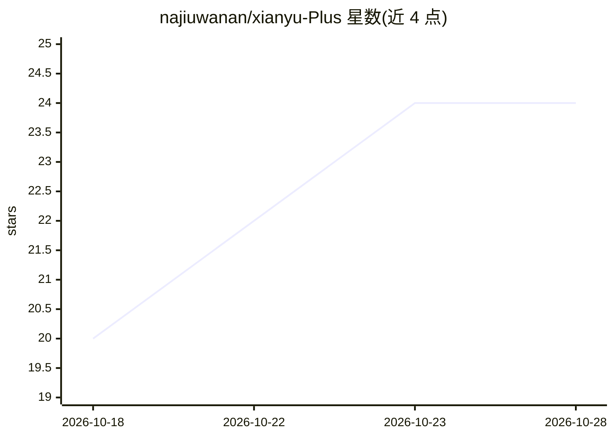

# najiuwanan/xianyu-Plus

⭐ 24 · Java · NOASSERTION · 推送 2026-07-31 · [GitHub](https://github.com/najiuwanan/xianyu-Plus) · 个人维护 · 中文 README

**私有部署的闲鱼多账号运营助手：客服、发货、订单一站管理**

面向个人卖家的闲鱼运营后台，本地或私有服务器部署，业务数据保留在自己设备与数据库中。功能覆盖多账号 Cookie/Token 管理、商品同步、订单状态跟踪、卡券库存（固定内容/本地卡密/图片/外部 API 四种交付）、自动发货与补发、自动评价与小红花、集中客服会话（手动回复、AI 回复、关键词规则、人工接管）及通知与日志排查。基于 Java 21 + Spring Boot + Vue 3 + MySQL，通过 Docker Compose 与安装脚本部署。采用 PolyForm Noncommercial 1.0.0 许可，仅限非商业用途，且与闲鱼平台无官方关联。

## 筛选速览

| 维度 | 判定 | 备注 |
|---|---|---|
| AI 角色 | `ai-enhanced` | 去掉 AI 部分产品仍成立 |
| 许可风险 | `none` | NOASSERTION |
| 部署形态 | `self-host` | docker 或自建部署 |
| 模型依赖 | — | README 未给出锁定关系 |
| 硬件要求 | — | 无带数字的原话,不猜 |
| 安装摩擦 | `low` | 无编译、无系统依赖或容器化 |
| 成熟度 | — | 结构信号不足 |

## 能力要点

- 多账号管理，集中查看 Cookie、WebSocket/H5 Token 与连接状态
- 卡券自动发货：固定内容、本地卡密、图片、外部 API 四种交付方式
- 订单页区分自动发货结果、平台确认、交易与评价状态，支持待人工核对
- AI 回复与关键词规则配置，支持人工接管会话

## 适用场景

- 多账号闲鱼卖家的订单同步与自动发货
- 卡密类商品的库存管理与防重复取卡
- 集中处理买家会话，异常时人工接管
- 在新订单、发货异常、凭证更新时收到通知

## 场景标签

`工作流自动化` · 领域:效率与自动化

## 证据(README 行号)

> L3:  私有部署的闲鱼多账号运营助手
> L23: XianYuPlus 把这些环节放到一套可查看、可追踪、可人工接管的工作台里。它适合本地或私有服务器部署，业务数据保留在自己的设备与数据库中。
> L50: |商品管理|同步商品，配置商品级或多规格独立自动发货、回复、AI 与关键词规则。|

## 星数曲线

2026-10-18 20 → 2026-10-28 24（+4）

---
*卡片 v1 · prompt 1.4 · 生成 2026-10-27 · 置信度 high · 依据 README sha `fad94f903b49` · [字段定义](../../DATASET.md)*
