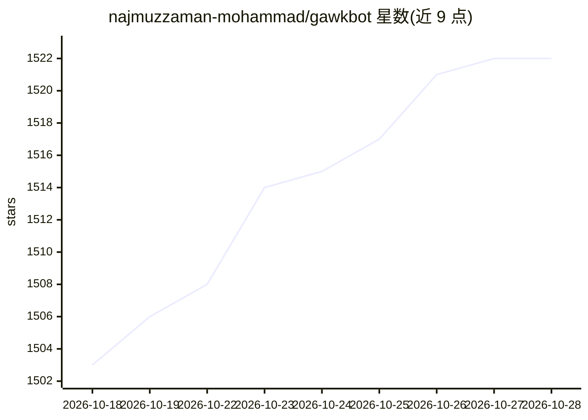

# najmuzzaman-mohammad/gawkbot

⭐ 1,522 · Go · NOASSERTION · 推送 2026-10-15 · [GitHub](https://github.com/najmuzzaman-mohammad/gawkbot) · [官网](https://gawk.bot) · 个人维护

**本地运行的 AI bot 管理平台：编排已有 agent CLI 并生成微应用**

在用户本机运行的 Grok Bot 开源替代：扫描并接管机器上已有的 agent CLI（Claude Code、Codex、Opencode、Ollama 等），由 Chief of Staff 统一调度；通过一句话描述工作流生成带独立界面、定时例程、工具与知识页面的微应用 bot，覆盖 1200+ 集成，外部写入操作均需人工审批，通知从 Mac 刘海或 iPhone 伴生应用弹出。Mac 提供签名 dmg，也可用 Go 和 Bun 从源码构建，支持本地模型与 OpenAI 兼容端点。采用 Sustainable Use License。

## 筛选速览

| 维度 | 判定 | 备注 |
|---|---|---|
| AI 角色 | `ai-ecosystem` | LLM/agent 周边工具 |
| 许可风险 | `none` | NOASSERTION |
| 部署形态 | `desktop` | 安装包/桌面程序 |
| 模型依赖 | local-ok | 支持本地模型 |
| 硬件要求 | — | 无带数字的原话,不猜 |
| 安装摩擦 | `low` | 无编译、无系统依赖或容器化 |
| 成熟度 | — | 结构信号不足 |

## 能力要点

- 自动发现并接管本机已有 agent CLI（Claude Code、Codex、Ollama、Gemini CLI 等 15+ 种）
- 工作流生成微应用 bot：独立界面、版本化例程、自编工具、带引用的知识页
- 所有外部写入（发送/提交/购买/删除）需经审批门
- 1200+ 集成，支持本地模型与 OpenAI 兼容端点（Ollama/LiteLLM/MLX-LM）

## 适用场景

- 把每周汇报、线索评分等重复工作流交给常驻 bot 自动执行
- 统一管理本机已有的多个编码 agent 并接收审批请求
- 在 Mac 刘海或 iPhone 上处理 bot 的提问与审批

## 场景标签

`工作流自动化` `Agent 框架` · 领域:Agent 开发

## 证据(README 行号)

> L21: Already running Claude Code, Codex or Opencode? gawkbot finds them, adopts
> L106: gawkbot looks for the agents already on your machine. It checks your `PATH`,
> L177: |`--provider <name>`|Runtime override (`claude-code`, `codex`, `opencode`, `ollama`, `hermes-agent`, `openclaw-htt

## 星数曲线

2026-10-18 1,503 → 2026-10-28 1,522（+19）

---
*卡片 v1 · prompt 1.4 · 生成 2026-10-21 · 置信度 high · 依据 README sha `dcb45f2e4485` · [字段定义](../../DATASET.md)*
