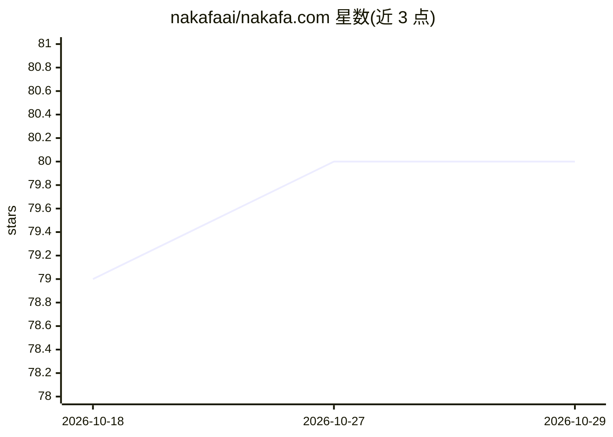

# nakafaai/nakafa.com

⭐ 80 · TypeScript · NOASSERTION · 推送 2026-10-27 · [GitHub](https://github.com/nakafaai/nakafa.com) · [官网](https://nakafa.com) · 组织维护

**面向 K-12 到大学学习的源码可见教育平台（结构化学习/测评/古兰经/政治分析）**

Nakafa 是生产站点 nakafa.com 的源码仓库，包含 React/Next.js 应用、设计系统、Convex 事务后端、渲染器与 Agent 能力契约；教学内容与签名发布工件由独立 Aksara 仓库拥有，本仓库仅消费已验证契约。技术栈为 Node.js 24、pnpm、Turborepo、Next.js 16、Convex、Vitest。本地开发需配置 Portless HTTPS 代理与 Google OAuth 凭据，另提供验收构建流程（隔离 Convex 数据库 + Aksara 签名发布）。采用 source-available 许可，README 声明非开源。

## 筛选速览

| 维度 | 判定 | 备注 |
|---|---|---|
| AI 角色 | `ai-enhanced` | 去掉 AI 部分产品仍成立 |
| 许可风险 | `none` | NOASSERTION |
| 部署形态 | `library` | 以包/库形式分发 |
| 模型依赖 | — | README 未给出锁定关系 |
| 硬件要求 | — | 无带数字的原话,不猜 |
| 安装摩擦 | `low` | 无编译、无系统依赖或容器化 |
| 成熟度 | — | 结构信号不足 |

## 能力要点

- React/Next.js + Convex 的多应用 monorepo（www/mcp/api/cas/email）
- 内容与签名发布由独立 Aksara 仓库拥有，本仓库只消费验证契约
- Portless 本地 HTTPS 代理与可复现的验收构建流程
- 英/印尼/德三语 locale 契约驱动路由、校验与结账本地化

## 适用场景

- 搭建并二次开发 nakafa.com 学习平台
- 在教育平台中接入 Agent 能力与多语言内容契约
- 本地复现生产模式验收测试

## 场景标签

`教程课程` · 领域:学习与行业

## 证据(README 行号)

> L5: Nakafa is a source-available educational platform for structured learning,
> L149: - `packages/backend`: Confect schema, functions, workflows, native Agent capabilities, and integrations
> L197: validation, Convex validators, AI language handling, date formatting, checkout

## 星数曲线

2026-10-18 79 → 2026-10-29 80（+1）

---
*卡片 v1 · prompt 1.4 · 生成 2026-10-24 · 置信度 low · 依据 README sha `969f22ce3cd5` · [字段定义](../../DATASET.md)*
