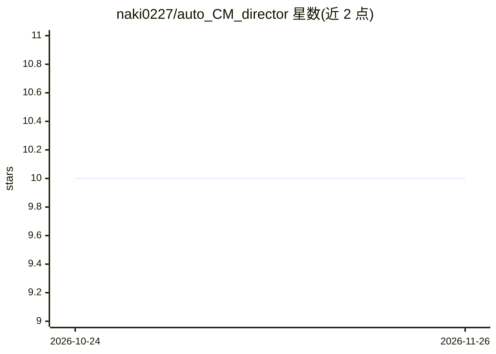

# naki0227/auto_CM_director

⭐ 10 · TypeScript · 推送 2026-01-27 · [GitHub](https://github.com/naki0227/auto_CM_director) · 个人维护

**让 AI Agent 自主导演并渲染软件项目宣传视频的框架**

混合架构的视频生成框架：AI 侧分析软件仓库、提取风格（Cyberpunk/Minimal/Playful）并生成结构化 director.json 配置；渲染侧基于 Remotion 的通用模板引擎负责成片输出。提供人类可用的 npx CLI 初始化与 npm 渲染流程，同时提供 MCP Server 供 Claude、ChatGPT 等 AI 客户端通过 generate_commercial 工具调用。支持在 Glama 或 Smithery 注册以便被其他 Agent 发现。许可证为 MIT。

## 筛选速览

| 维度 | 判定 | 备注 |
|---|---|---|
| AI 角色 | `ai-native` | 本体是模型或模型工具 |
| 许可风险 | `none` | — |
| 部署形态 | `library` | 以包/库形式分发 |
| 模型依赖 | — | README 未给出锁定关系 |
| 硬件要求 | — | 无带数字的原话,不猜 |
| 安装摩擦 | `low` | 无编译、无系统依赖或容器化 |
| 成熟度 | — | 结构信号不足 |

## 能力要点

- 混合模板引擎：AI 生成 director.json，Remotion 渲染成片
- 提供 MCP Server，AI 客户端可调用 generate_commercial 工具
- 三种主题模板（Cyberpunk/Minimal/Playful）对应不同产品类型
- npx 一行命令初始化项目脚手架

## 适用场景

- 为开源软件项目自动生成宣传/推广视频
- 让 AI Agent 通过 MCP 自动化视频制作流程
- 按产品类型选择主题模板快速产出宣传片

## 场景标签

`视频生成` · 领域:内容生成

## 证据(README 行号)

> L3: > **The Agentic Video Generation Framework.**
> L53: 1. **AI (The Creative Director):** Analyzes the repository, extracts the "Vibe" (Cyberpunk, Minimal, Playful), and 

## 星数曲线

2026-10-24 10 → 2026-11-26 10（+0）

---
*卡片 v1 · prompt 1.4 · 生成 2026-11-19 · 置信度 mid · 依据 README sha `dca4bba01d82` · [字段定义](../../DATASET.md)*
