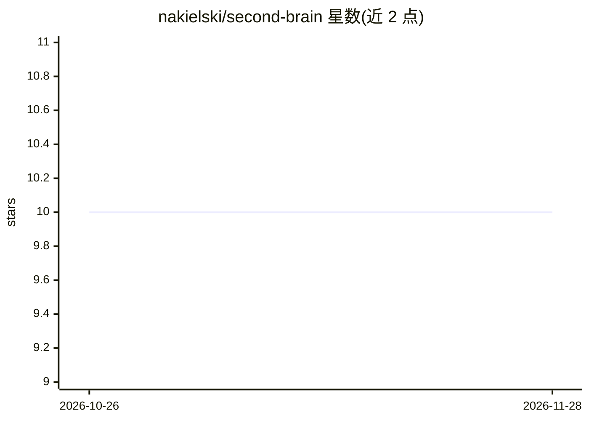

# nakielski/second-brain

⭐ 10 · MIT · 推送 2026-11-04 · [GitHub](https://github.com/nakielski/second-brain) · 个人维护

**让 AI agent 交互式搭建 Obsidian 第二大脑知识库的引导清单**

一套供 AI agent（Claude、Cursor、Gemini 等可读写文件的 LLM）读取执行的 Markdown 清单系统，由 1 个编排入口、12 个章节指令与 42 个模板文件组成，从零生成包含三层架构（raw/wiki/system）、五项核心操作（Ingest/Query/Lint/Review/Eval）与 Agent Memory Protocol 的 Obsidian 仓库。纯 Markdown 实现，无 Python/Node/Bash 运行时；需安装 Obsidian，可选 Dataview/Templater 插件。通过 8 个交互问题个性化配置，支持中断续跑与多 agent 并发写入日志。

## 筛选速览

| 维度 | 判定 | 备注 |
|---|---|---|
| AI 角色 | `ai-knowledge` | 知识聚合/清单类 |
| 许可风险 | `permissive` | MIT |
| 部署形态 | `None` |  |
| 模型依赖 | — | README 未给出锁定关系 |
| 硬件要求 | — | 无带数字的原话,不猜 |
| 安装摩擦 | `low` | 无编译、无系统依赖或容器化 |
| 成熟度 | — | 结构信号不足 |

## 能力要点

- 12 章节指令 + 42 个模板文件构成可执行的 bootstrap 清单
- 三层架构 raw/wiki/system 与 11 条强制规则（VAULT.md）
- append-only 写入日志与作用域锁支持多 agent 并发
- Interrupted bootstrap 可经 BOOTSTRAP-STATE.md 续跑

## 适用场景

- 用 AI agent 从零搭建带治理规则的 Obsidian 个人知识库
- 让 agent 定期执行知识库健康检查与矛盾消解
- 多 agent 协作维护同一 vault 并追溯写入来源

## 场景标签

`知识库管理` · 领域:知识与检索

## 证据(README 行号)

> L3: > **Interactive Bootstrap Manifest for AI-agent-driven Obsidian Second Brain vaults.**
> L10: A modular template system that an AI agent (Claude, Cursor, Gemini, or any capable
> L104: - **Vendor-agnostic by design** — Pure Markdown. No runtime, no CLI, no install

## 星数曲线

2026-10-26 10 → 2026-11-28 10（+0）

---
*卡片 v1 · prompt 1.4 · 生成 2026-11-19 · 置信度 mid · 依据 README sha `f8816b5adb76` · [字段定义](../../DATASET.md)*
