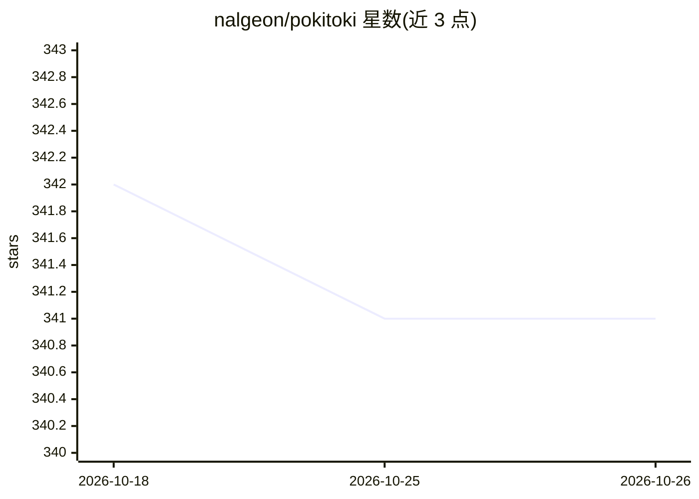

# nalgeon/pokitoki

⭐ 341 · Python · MIT · 推送 2026-10-24 · [GitHub](https://github.com/nalgeon/pokitoki) · 个人维护

**接入 OpenAI 兼容 API 的 Telegram 聊天机器人**

自托管的 Telegram AI 助手：通过 OpenAI 兼容 API 调用大语言模型（OpenAI、OpenRouter、Nebius、Gemini 等），支持私聊与群组、@提及与追问、抓取外部链接正文喂给模型、自定义快捷命令、按聊天设置提示词与模型、消息频率限额与在线 /config 免重启改配置。默认不记忆聊天上下文，外链与文件问答仅支持文本。通过 git clone 加 docker compose 部署，需自备 AI API key 与 BotFather 的 bot token。

## 筛选速览

| 维度 | 判定 | 备注 |
|---|---|---|
| AI 角色 | `ai-native` | 本体是模型或模型工具 |
| 许可风险 | `permissive` | MIT |
| 部署形态 | `self-host` | docker 或自建部署 |
| 模型依赖 | — | README 未给出锁定关系 |
| 硬件要求 | — | 无带数字的原话,不猜 |
| 安装摩擦 | `low` | 无编译、无系统依赖或容器化 |
| 成熟度 | — | 结构信号不足 |

## 能力要点

- 抓取外部链接文本内容后交给模型回答
- 自定义快捷命令（内置 proofread/translate/summarize/bugfix 等）
- /config 命令免重启修改几乎全部配置
- 群组按用户/时段设置消息限额控制 API 开销

## 适用场景

- 在 Telegram 私聊或群里有一个随时可问的 AI 助手
- 让 bot 读取文章或代码链接后回答相关问题
- 用自定义快捷命令做校对、翻译、总结等固定任务

## 场景标签

`聊天机器人` `AI 助手` · 领域:对话与助手

## 证据(README 行号)

> L3: This is a Telegram chat bot (AI assistant) that uses large language models from OpenAI-compatible providers (like Op
> L18: The bot acts as your personal assistant:

## 星数曲线

2026-10-18 342 → 2026-10-26 341（-1）

---
*卡片 v1 · prompt 1.4 · 生成 2026-10-21 · 置信度 mid · 依据 README sha `df41ed363f03` · [字段定义](../../DATASET.md)*
