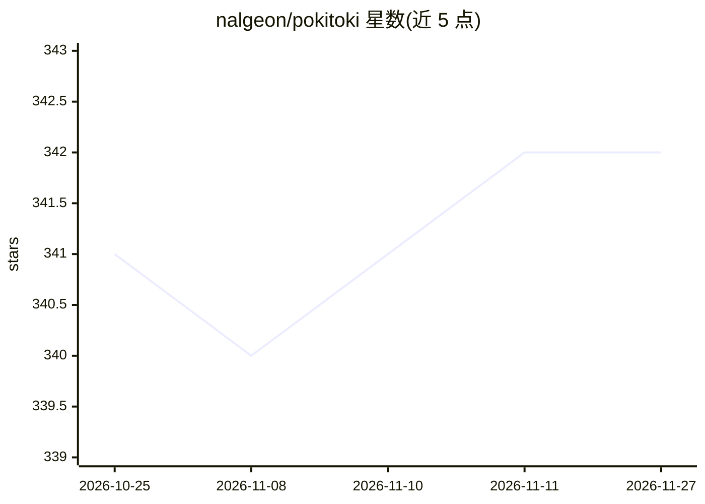

# nalgeon/pokitoki

⭐ 342 · Python · MIT · 推送 2026-10-24 · [GitHub](https://github.com/nalgeon/pokitoki) · 个人维护

**接入 OpenAI/Claude/Gemini 等模型的 Telegram AI 聊天机器人**

一个 Telegram 聊天机器人（AI 助手），调用 OpenAI、Claude、Gemini 或任意 OpenAI 兼容提供商（如 OpenRouter、Nebius）的大语言模型生成回复。支持私聊与群聊、5 分钟内多轮对话延续、网页搜索与外部链接读取、自定义快捷命令、按聊天配置 prompt 与模型，并可通过 /config 命令在不重启的情况下动态修改配置。部署方式为克隆仓库后配置 API key 与 bot token，用 docker compose 启动；仅支持文本内容（文章、代码、数据），不支持 PDF、图片或音频。

## 筛选速览

| 维度 | 判定 | 备注 |
|---|---|---|
| AI 角色 | `ai-native` | 本体是模型或模型工具 |
| 许可风险 | `permissive` | MIT |
| 部署形态 | `self-host` | docker 或自建部署 |
| 模型依赖 | locked-api |  |
| 硬件要求 | — | 无带数字的原话,不猜 |
| 安装摩擦 | `low` | 无编译、无系统依赖或容器化 |
| 成熟度 | — | 结构信号不足 |

## 能力要点

- 支持 OpenAI/Claude/Gemini 及任意 OpenAI 兼容提供商
- 私聊与群聊均可使用，支持多轮对话延续与 /new、/retry 等命令
- 内置网页搜索与外部链接内容读取（依赖提供商服务端工具）
- 自定义快捷命令（bugfix/proofread/translate/summarize）与按聊天的 prompt/模型设置

## 适用场景

- 在 Telegram 私聊中让 AI 解答问题、翻译或校对文字
- 在群聊中 @机器人 回答成员提出的问题
- 转发消息或发送文件让 AI 读取并回答相关问题

## 场景标签

`聊天机器人` `AI 助手` · 领域:对话与助手

## 证据(README 行号)

> L3: This is a Telegram chat bot (AI assistant) that uses large language models from OpenAI, Claude, Gemini or any OpenAI
> L18: The bot acts as your personal assistant:

## 星数曲线

2026-10-25 341 → 2026-11-27 342（+1）

---
*卡片 v1 · prompt 1.4 · 生成 2026-11-25 · 置信度 high · 依据 README sha `a5c9c76a9d99` · [字段定义](../../DATASET.md)*
