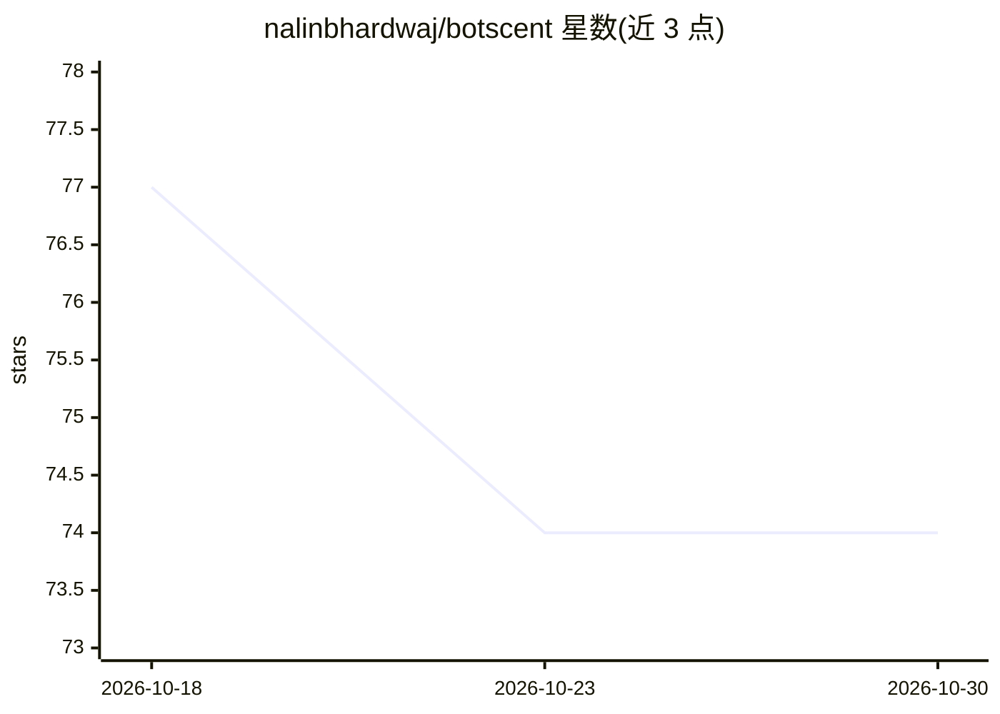

# nalinbhardwaj/botscent

⭐ 74 · TypeScript · MIT · 推送 2026-10-08 · [GitHub](https://github.com/nalinbhardwaj/botscent) · [官网](https://botscent.nibnalin.me) · 个人维护

**网站检测 AI agent 访问并识别其身份的前端/服务端库**

供网站开发者使用的 TypeScript/Python 库，判断访问者是 AI agent 还是 human，并给出 agent 名称。由两半组成：服务端半读取请求头，校验 Web Bot Auth 签名、user-agent 标记与主机 verified-bot 字段；页面半监测页面中的自动化标志、agent 云浏览器与扩展标记。约 5 KB、0 依赖、无网络请求、无 cookie。提供 Next.js/React/Vue/Express/FastAPI 等十余框架适配与 `npx botscent check` 验证命令；明确信任模型：仅请求自身判定的 isVerified 可用于访问控制，页面判定可被伪造。

## 筛选速览

| 维度 | 判定 | 备注 |
|---|---|---|
| AI 角色 | `ai-ecosystem` | LLM/agent 周边工具 |
| 许可风险 | `permissive` | MIT |
| 部署形态 | `library` | 以包/库形式分发 |
| 模型依赖 | — | README 未给出锁定关系 |
| 硬件要求 | — | 无带数字的原话,不猜 |
| 安装摩擦 | `medium` | 含编译或系统依赖之一 |
| 成熟度 | — | 结构信号不足 |

## 能力要点

- 双半判定：服务端校验 Web Bot Auth 签名与请求头，页面端监测自动化/扩展标记
- 约 5 KB、0 依赖、无网络请求、无 cookie、无存储
- 识别 Claude for Chrome、ChatGPT for Chrome、Devin、Codex 等多种 agent
- TypeScript 与 Python 双语言，覆盖十余框架并附 `npx botscent check` 安装验证

## 适用场景

- 检测到 agent 访问时隐藏广告、改价或简化页面
- 按 agent 名称统计并记录站点上的 agent 流量
- 在服务端基于 isVerified 放行已验证 agent 或拦截未验证 agent

## 场景标签

 · 领域:Web 开发/流量检测

## 证据(README 行号)

> L5: Botscent tells your site if an AI agent is browsing it, and which agent.
> L27: - **The server half** reads the request headers. It checks a Web Bot Auth signature, a user-agent token and your ho
> L249: ## The trust model

## 星数曲线

2026-10-18 77 → 2026-10-30 74（-3）

---
*卡片 v1 · prompt 1.4 · 生成 2026-10-24 · 置信度 high · 依据 README sha `9c5f0da01df6` · [字段定义](../../DATASET.md)*
