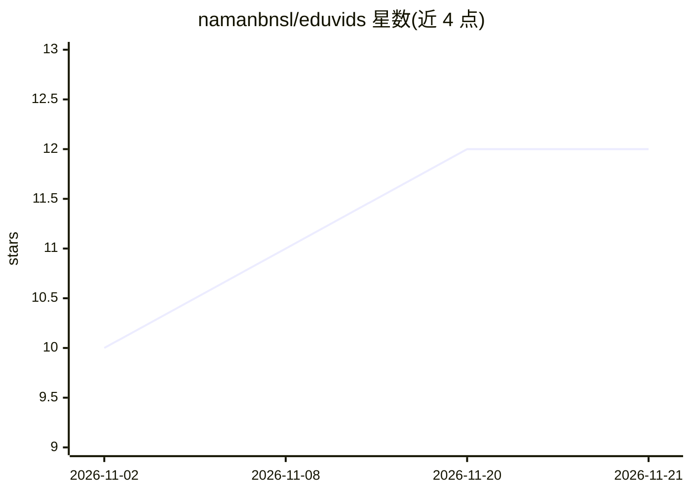

# namanbnsl/eduvids

⭐ 12 · TypeScript · MIT · 推送 2026-11-14 · [GitHub](https://github.com/namanbnsl/eduvids) · [官网](https://eduvids.app) · 个人维护

**输入主题即可生成 Manim 旁白动画教学视频**

Web 应用：用户输入主题后，系统用 LLM 规划课程、撰写旁白并生成 Manim 场景代码，在 E2B 沙箱中渲染视频，再对齐语音与画面，输出横屏视频或竖屏 Short 及缩略图。免费且无需注册，支持多语言。自托管需 Node/Bun、E2B CLI 及多个云服务账号（Google AI、Convex、Upstash、UploadThing、Clerk），语音默认走 gTTS，可配置 DeepSeek/OpenRouter 语音服务提升英文音质，支持自动上传 YouTube 与 X。

## 筛选速览

| 维度 | 判定 | 备注 |
|---|---|---|
| AI 角色 | `ai-native` | 本体是模型或模型工具 |
| 许可风险 | `permissive` | MIT |
| 部署形态 | `library` | 以包/库形式分发 |
| 模型依赖 | — | README 未给出锁定关系 |
| 硬件要求 | — | 无带数字的原话,不猜 |
| 安装摩擦 | `low` | 无编译、无系统依赖或容器化 |
| 成熟度 | — | 结构信号不足 |

## 能力要点

- LLM 规划课程并生成 Manim 场景代码，全部帧由代码绘制
- E2B 沙箱渲染，语音与画面自动对时
- 输出横屏视频或竖屏 Short 并生成缩略图
- 支持自动上传 YouTube 与自动发布 X

## 适用场景

- 为数学等知识点快速生成带旁白的动画教学视频
- 制作横屏课程视频或竖屏短视频内容
- 自托管一套教学视频自动生成流水线

## 场景标签

`视频生成` · 领域:内容生成

## 证据(README 行号)

> L3:  Type a topic. Get a narrated, animated lesson.
> L17: Every frame above is drawn by code. eduvids plans the lesson, writes the narration, writes Manim scenes for each be

## 星数曲线

2026-11-02 10 → 2026-11-21 12（+2）

---
*卡片 v1 · prompt 1.4 · 生成 2026-11-18 · 置信度 high · 依据 README sha `81aaf35a4aa7` · [字段定义](../../DATASET.md)*
