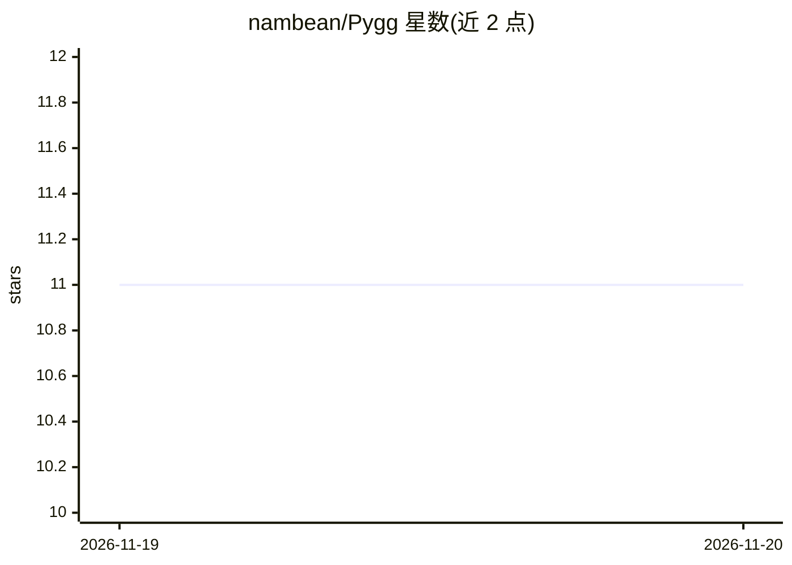

# nambean/Pygg

⭐ 11 · Rust · MIT · 推送 2026-11-19 · [GitHub](https://github.com/nambean/Pygg) · [官网](http://inviv.vn) · 个人维护

**为编程 agent 提供本地网关：路由多模型并记录请求成本**

运行在 127.0.0.1:8741 的本地网关：用户一次性接入已有 API key、coding plan、本地 Ollama 或无 API 的 AI 网站，把 Claude Code、Codex、OpenCode、编辑器或 SDK 指向网关并用 auto 模型名，请求按规则路由到低价可用模型，429/402 时回退到下一目标；每次尝试写入 SQLite 账本记录成本及来源（actual/estimated/unknown）。提供 Windows x64 桌面应用与 npm CLI（Windows/macOS/Linux），状态为 developer preview，安装包未代码签名。

## 筛选速览

| 维度 | 判定 | 备注 |
|---|---|---|
| AI 角色 | `ai-ecosystem` | LLM/agent 周边工具 |
| 许可风险 | `permissive` | MIT |
| 部署形态 | `desktop` | 安装包/桌面程序 |
| 模型依赖 | local-ok | 支持本地模型 |
| 硬件要求 | — | 无带数字的原话,不猜 |
| 安装摩擦 | `low` | 无编译、无系统依赖或容器化 |
| 成熟度 | `idea` | |

## 能力要点

- 规则化 auto 路由：最多 5 个模型、单连接最多 2 个，每个响应说明选择原因
- 成本账本区分 actual/estimated/unknown 三种来源，不以 $0 显示
- key ring 多账号轮换（round robin/quota aware），每个 key 独立冷却
- 发送前写盘的 journal 与预算预扣，防止并发超出月度限额

## 适用场景

- 让编程 agent 用已接入的更便宜模型完成任务并追踪每笔花费
- 多个 API key 或账号按顺序轮换以应对限流
- 以统一端点同时接入 OpenAI 与 Anthropic 格式的工具

## 场景标签

`模型网关` · 领域:Agent 开发

## 证据(README 行号)

> L19: Pygg runs on your computer. Connect your providers once (API keys, coding plans, a local Ollama, even an AI website
> L48: 1. **Gateway.** The agent calls `127.0.0.1:8741` with its own Pygg API key, in OpenAI Chat Completions, OpenAI Resp
> L147: - **One Rust crate** (Tauri 2): the gateway (axum), the SQLite store, the OS credential store, web-session windows

## 星数曲线

2026-11-19 11 → 2026-11-20 11（+0）

---
*卡片 v1 · prompt 1.4 · 生成 2026-11-19 · 置信度 high · 依据 README sha `18e6215bb9d3` · [字段定义](../../DATASET.md)*
