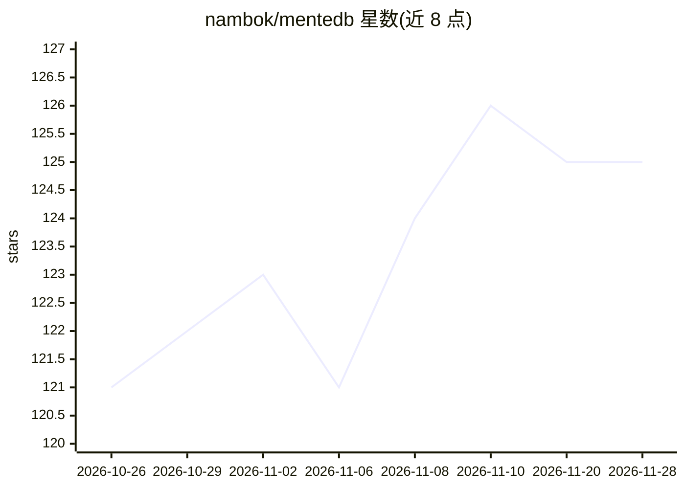

# nambok/mentedb

⭐ 125 · Rust · Apache-2.0 · 推送 2026-11-27 · [GitHub](https://github.com/nambok/mentedb) · [官网](https://mentedb.com) · 个人维护

**为 AI agent 记忆打造的 Rust 认知型数据库引擎**

MenteDB 是一个从零构建的 Rust 存储引擎，用于管理 AI agent 的长期记忆：写入时做 LLM 抽取、实体消解、质量过滤、去重与矛盾检测，检索时融合 HNSW 向量、BM25 与知识图谱遍历，并按 token 预算与 U 曲线组装上下文。核心认知管线不依赖 LLM；更丰富的语义抽取通过配置 provider 使用。可通过云托管 API key 使用，或用 cargo/Docker 自托管；提供 Python/TypeScript SDK、CLI、MQL 查询语言，以及 LangChain/CrewAI 集成包和 MCP 接入。

## 筛选速览

| 维度 | 判定 | 备注 |
|---|---|---|
| AI 角色 | `ai-ecosystem` | LLM/agent 周边工具 |
| 许可风险 | `permissive` | Apache-2.0 |
| 部署形态 | `self-host` | docker 或自建部署 |
| 模型依赖 | local-ok | 支持本地模型 |
| 硬件要求 | — | 无带数字的原话,不猜 |
| 安装摩擦 | `low` | 无编译、无系统依赖或容器化 |
| 成熟度 | — | 结构信号不足 |

## 能力要点

- 写入时智能：抽取、实体图谱、质量过滤、去重、矛盾检测与信念传播
- 混合检索：HNSW 向量 + BM25 + 图遍历的倒数排名融合，可选重排与 MMR 多样性
- 双时间线有效性与增量感知服务（减少记忆检索 token）
- gRPC、REST、MCP 三种集成路径与记忆空间 ACL 隔离

## 适用场景

- 为多轮对话 agent 存储和召回结构化长期记忆
- 通过 MCP 让 Claude Code/Cursor 等 assistant 每轮自动读写记忆
- 多 agent 场景下按记忆空间做隔离与权限控制
- 自托管为多个租户提供记忆数据库服务

## 场景标签

`Agent 记忆` `知识图谱` · 领域:Agent 开发

## 证据(README 行号)

> L7: MenteDB is a purpose built database engine for AI agent memory. Not a wrapper around existing databases, but a groun
> L101: Memory is one call. `process_turn` embeds the user message, recalls what is
> L197: - **LLM Powered Cognitive Inference** CognitiveLlmService judges whether new memories invalidate, update, or are c

## 星数曲线

2026-10-26 121 → 2026-11-28 125（+4）

---
*卡片 v1 · prompt 1.4 · 生成 2026-11-28 · 置信度 high · 依据 README sha `ca712eb92ae8` · [字段定义](../../DATASET.md)*
