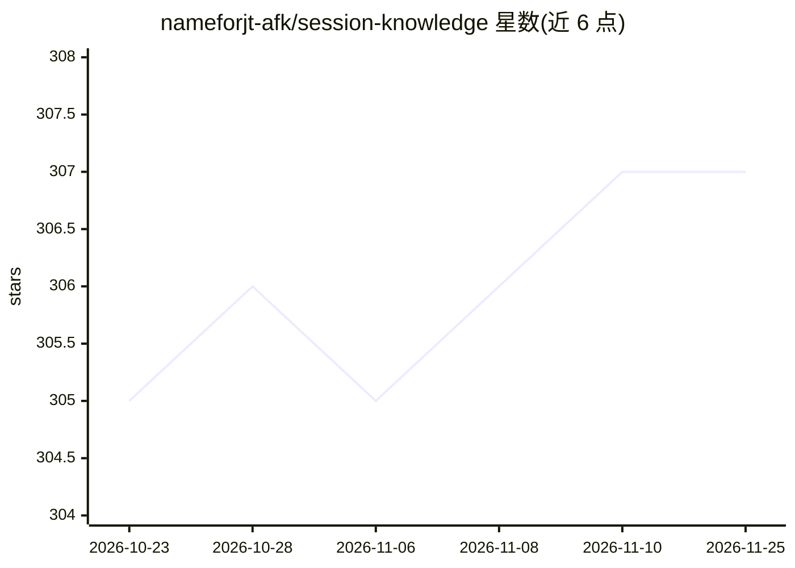

# nameforjt-afk/session-knowledge

⭐ 307 · Python · MIT · 推送 2026-10-23 · [GitHub](https://github.com/nameforjt-afk/session-knowledge) · 个人维护 · 中文 README

**把 Claude Code 会话历史索引成可搜索的本地知识库**

读取 `~/.claude/projects` 下已有的会话记录，本地建立全文索引与代码能力索引，通过 MCP 提供 13 个工具供 Claude Code 在对话中检索历史决策、命令调用、实现与凭据候选。纯 Python 标准库实现，无嵌入、无 API 调用；索引含脱敏处理（凭据指纹替换，明文存于 0600 权限的 vault.db）。限制：仅支持 Claude Code 记录，代码索引仅覆盖 Python/JS/TS，脱敏为模式匹配、自定义格式密钥可能漏检。

## 筛选速览

| 维度 | 判定 | 备注 |
|---|---|---|
| AI 角色 | `ai-ecosystem` | LLM/agent 周边工具 |
| 许可风险 | `permissive` | MIT |
| 部署形态 | `None` |  |
| 模型依赖 | — | README 未给出锁定关系 |
| 硬件要求 | — | 无带数字的原话,不猜 |
| 安装摩擦 | `low` | 无编译、无系统依赖或容器化 |
| 成熟度 | — | 结构信号不足 |

## 能力要点

- 13 个 MCP 工具：会话全文检索、时间线重建、决策演化追踪、实现去重等
- 纯标准库实现，无第三方依赖、无嵌入、无网络调用
- 凭据脱敏（⟦SECRET:指纹⟧）+ 权限 0700/0600 的本地存储策略
- CJK bigram 预分词支持中文全文检索，保留 BM25 排序

## 适用场景

- 跨项目找回以前会话里解决过的配置与决策
- 查询某个外部服务（如支付、鉴权）是否已有现成实现
- 检索历史中真实使用过的环境变量/密钥候选值
- 回顾曾经失败的 Bash/MCP 调用以避开坑

## 场景标签

`知识库管理` · 领域:知识与检索

## 证据(README 行号)

> L14: This indexes all of it and hands Claude 13 MCP tools to search it. You just ask normally.
> L114: ## The 13 MCP tools
> L187: - **Claude Code transcripts only** (`~/.claude/projects/**/*.jsonl`). Not Cursor, not Copilot.

## 星数曲线

2026-10-23 305 → 2026-11-25 307（+2）

---
*卡片 v1 · prompt 1.4 · 生成 2026-11-25 · 置信度 high · 依据 README sha `063c4fc854d1` · [字段定义](../../DATASET.md)*
