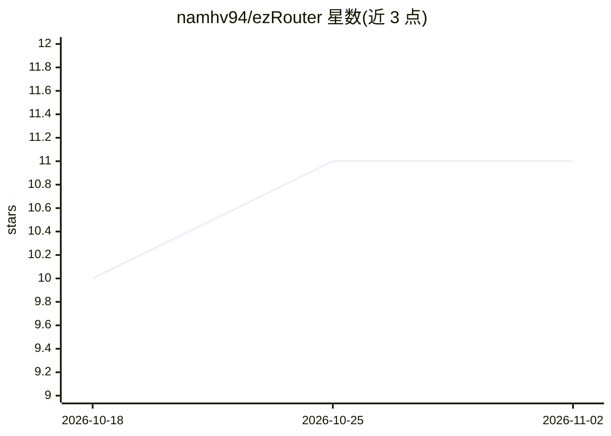

# namhv94/ezRouter

⭐ 11 · Rust · MIT · 推送 2026-10-23 · [GitHub](https://github.com/namhv94/ezRouter) · 组织维护

**Rust 编写的 LLM 代理与路由网关，多账号配额池化**

面向 AI 工程的 LLM 代理/路由网关，用纯 Rust（Tokio + Axum 0.7）实现，提供 OpenAI 兼容 API（chat/completions、models、embeddings、images，含 SSE 流式）。核心机制：Google Antigravity 与 OpenAI Codex 的多账号 OAuth 配额池化与轮换、自定义 provider 透传（DeepSeek/Groq/Ollama/vLLM 等）、429/5xx 熔断与故障转移链、Token Saver 提示词压缩（RTK/Caveman/Ponytail 三种模式）。二进制内嵌 React Web 管理控制台，支持越南语/英语。配置经环境变量与 .env，健康检查在 /health。

## 筛选速览

| 维度 | 判定 | 备注 |
|---|---|---|
| AI 角色 | `ai-ecosystem` | LLM/agent 周边工具 |
| 许可风险 | `permissive` | MIT |
| 部署形态 | `self-host` | docker 或自建部署 |
| 模型依赖 | local-ok | 支持本地模型 |
| 硬件要求 | — | 无带数字的原话,不猜 |
| 安装摩擦 | `low` | 无编译、无系统依赖或容器化 |
| 成熟度 | — | 结构信号不足 |

## 能力要点

- 多账号 OAuth 配额池化：Google Antigravity、OpenAI Codex（PKCE）
- Token Saver 引擎在转发前做提示词压缩（三种模式）
- 100% OpenAI API 兼容端点，SSE 流式与 tool call
- 二进制内嵌 Web 管理控制台（配额、流量、密钥管理，双语）

## 适用场景

- 为 Claude Code / Cursor 等工具统一接入多家模型 provider
- 多账号轮换与熔断故障转移规避 rate limit
- 在请求管线中压缩提示词以降低 token 用量
- 将多个物理模型组合为虚拟端点做加权/优先级路由

## 场景标签

`模型网关` · 领域:Agent 开发

## 证据(README 行号)

> L29: **ezRouter** is an ultra-fast, memory-safe LLM proxy & router developed by **EzLabs** for modern AI engineering. Wr
> L31: Whether you are orchestrating high-concurrency coding agents (Hermes, Claude Code, Cursor, OpenCode), running RAG p

## 星数曲线

2026-10-18 10 → 2026-11-02 11（+1）

---
*卡片 v1 · prompt 1.4 · 生成 2026-11-01 · 置信度 high · 依据 README sha `64d73dab363f` · [字段定义](../../DATASET.md)*
