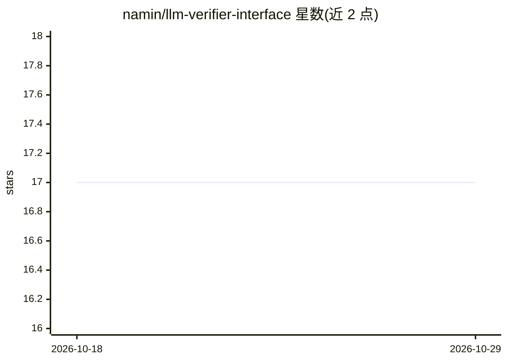

# namin/llm-verifier-interface

⭐ 17 · Python · 推送 2026-07-14 · [GitHub](https://github.com/namin/llm-verifier-interface) · 个人维护

**LLM-Verifier 接口课程讲义仓库：形式化验证与 LLM 结合的代码示例与文献清单**

FoPSS 2026 暑期学校课程配套仓库，围绕 LLM 与验证器（Verifier）的接口组织内容：agentic loop 示例（agent.py、dafny_agent.py、henri）、验证在环的生成-验证-重试循环、MCTS 与 CEGIS、部分验证、任务分解（Draft-Sketch-Prove）、自动形式化、主流语言验证（Verus/Frama-C/LemmaScript）、agent 安全守卫（guardians）、自我改进 agent 与验证作为训练信号。条目多为论文引用与配套小型 Python/TypeScript 示例，面向学习与研究者。

## 筛选速览

| 维度 | 判定 | 备注 |
|---|---|---|
| AI 角色 | `ai-knowledge` | 知识聚合/清单类 |
| 许可风险 | `none` | — |
| 部署形态 | `None` |  |
| 模型依赖 | — | README 未给出锁定关系 |
| 硬件要求 | — | 无带数字的原话,不猜 |
| 安装摩擦 | `low` | 无编译、无系统依赖或容器化 |
| 成熟度 | — | 结构信号不足 |

## 能力要点

- verifier_loop.py / cegis.py / sketch.py 等可运行的最小示例
- 覆盖 VerMCTS、AlphaProof、Lemur、AlphaGeometry 等文献线索
- guardians：对 agent 计划做污点分析与 Z3 前置条件检查的 Python 实现

## 适用场景

- 学习 LLM 与形式化验证结合的课程内容
- 查找验证在环、自我改进 agent 方向的论文与代码
- 获取可运行的最小 CEGIS/分解验证示例

## 场景标签

`科研工具` `教程课程` · 领域:学习与行业

## 证据(README 行号)

> L3: Based on lectures on the LLM-Verifier Interface at the Summer School on Foundations of Programming and Software Syst
> L17: - verifier_loop.py: generate, verify, retry until Dafny accepts

## 星数曲线

2026-10-18 17 → 2026-10-29 17（+0）

---
*卡片 v1 · prompt 1.4 · 生成 2026-10-29 · 置信度 high · 依据 README sha `8cbe43b04dd3` · [字段定义](../../DATASET.md)*
