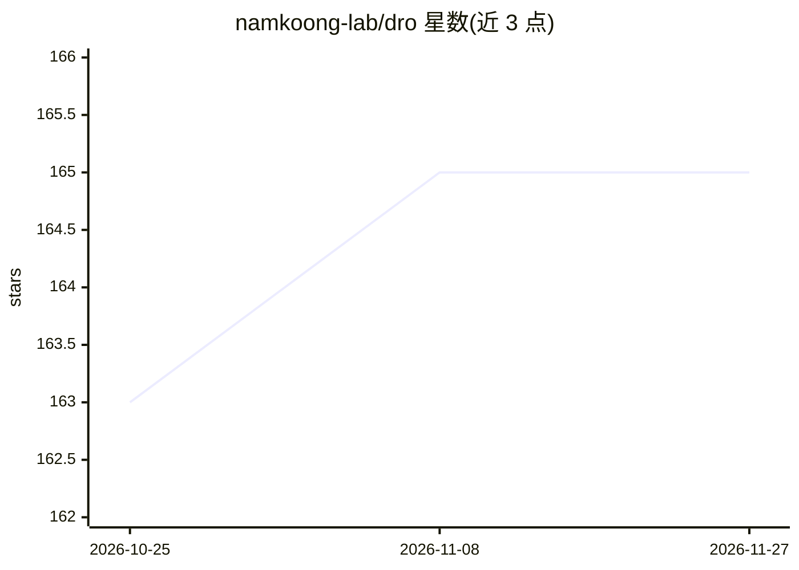

# namkoong-lab/dro

⭐ 165 · HTML · MIT · 推送 2026-10-25 · [GitHub](https://github.com/namkoong-lab/dro) · [官网](https://python-dro.org/) · 组织维护

**面向机器学习研究者的分布式鲁棒优化 Python 库**

基于 cvxpy 与 PyTorch 实现典型 DRO 方法的 Python 包，覆盖线性损失下的监督学习任务（SVM、逻辑回归、线性回归），支持多种距离度量与基模型。提供合成数据生成、线性/神经网络/树模型三类 DRO 实现，线性模型由 cvxpy 精确求解器求解，神经网络模型用 PyTorch 梯度下降求解，树模型基于 xgboost 与 lightgbm。默认使用开源求解器 CLARABEL，无需商业求解器许可；MOSEK/GUROBI 为可选加速方案，需自行申请许可。提供最坏情形分布与样本外性能的诊断接口。

## 筛选速览

| 维度 | 判定 | 备注 |
|---|---|---|
| AI 角色 | `ai-native` | 本体是模型或模型工具 |
| 许可风险 | `permissive` | MIT |
| 部署形态 | `library` | 以包/库形式分发 |
| 模型依赖 | — | README 未给出锁定关系 |
| 硬件要求 | — | 无带数字的原话,不猜 |
| 安装摩擦 | `low` | 无编译、无系统依赖或容器化 |
| 成熟度 | — | 结构信号不足 |

## 能力要点

- 线性、神经网络、树模型三类 DRO 模型实现
- 多种距离度量（χ²、KL、CVaR、TV、Wasserstein、Sinkhorn、MMD 等）
- 默认 CLARABEL 开源求解器，无需商业许可
- worst_distribution 与 evaluate 诊断接口

## 适用场景

- 在监督学习任务上训练对分布偏移鲁棒的模型
- 复现论文中的合成数据实验
- 评估模型的最坏情形分布与样本外性能

## 场景标签

 · 领域:机器学习/优化库

## 证据(README 行号)

> L13: `dro` is a python package that implements typical DRO methods on linear loss (SVM, logistic regression, and linear 
> L109: ### (2) Linear DRO models
> L175: ### (3) NN DRO models

## 星数曲线

2026-10-25 163 → 2026-11-27 165（+2）

---
*卡片 v1 · prompt 1.4 · 生成 2026-11-27 · 置信度 high · 依据 README sha `82a2ffa73d5f` · [字段定义](../../DATASET.md)*
