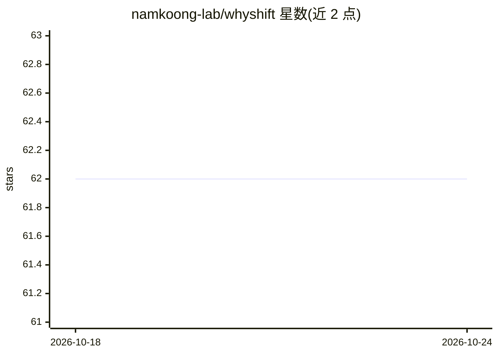

# namkoong-lab/whyshift

⭐ 62 · Jupyter Notebook · NOASSERTION · 推送 2026-07-23 · [GitHub](https://github.com/namkoong-lab/whyshift) · 组织维护

**表格数据分布偏移基准包：提供指定偏移模式的测试床**

Python 包 WhyShift，基于真实表格数据（ACS Income/PubCov/Mobility、Taxi、US Accident 共 5 个数据集）构建带指定分布偏移模式（空间/时间/合成）的基准：提供 get_data 按 task/state/year 加载数据、20 余种表格分类算法实现（含 DRO/DORO、Group DRO、JTT、公平性方法等）、风险区域识别算法 risk_region，以及将性能下降归因到 Y|X 偏移与 X 偏移的 DISDE 分解方法。面向做分布偏移研究的研究者，配套 NeurIPS 2023 论文与 Notebook 示例。

## 筛选速览

| 维度 | 判定 | 备注 |
|---|---|---|
| AI 角色 | `ai-knowledge` | 知识聚合/清单类 |
| 许可风险 | `permissive` | NOASSERTION |
| 部署形态 | `library` | 以包/库形式分发 |
| 模型依赖 | — | README 未给出锁定关系 |
| 硬件要求 | — | 无带数字的原话,不猜 |
| 安装摩擦 | `low` | 无编译、无系统依赖或容器化 |
| 成熟度 | — | 结构信号不足 |

## 能力要点

- 5 个真实表格数据集、22 种源-目标域偏移设定（空间/时间/合成）
- 实现 Logistic 回归/XGBoost/LightGBM/DRO/DORO/JTT/公平性等 20 余种方法
- DISDE 分解：将性能退化归因到 Y|X 偏移与 X 偏移
- 风险区域识别算法 risk_region

## 适用场景

- 我需要在带指定分布偏移的数据上评测我的分类算法
- 我想把模型性能下降分解为 X 偏移与 Y|X 偏移的贡献
- 我想复现论文中的表格数据偏移基准实验

## 场景标签

`模型评测` · 领域:评测与运维

## 证据(README 行号)

> L11: `WhyShift` is a python package that provides a benchmark with various specified distribution shift patterns on real
> L114: ## Different Distribution Shift Patterns
> L144: ## Implemented Algorithms

## 星数曲线

2026-10-18 62 → 2026-10-24 62（+0）

---
*卡片 v1 · prompt 1.4 · 生成 2026-10-24 · 置信度 high · 依据 README sha `5e71c4d95174` · [字段定义](../../DATASET.md)*
