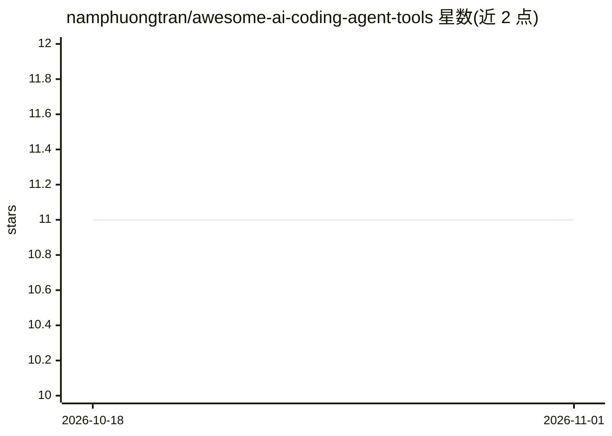

# namphuongtran/awesome-ai-coding-agent-tools

⭐ 11 · MIT · 推送 2026-05-31 · [GitHub](https://github.com/namphuongtran/awesome-ai-coding-agent-tools) · 个人维护

**AI 编程 agent 生态工具策展清单：技能、插件、MCP 服务器与框架**

策展 AI 编程 agent 周边生态的 awesome 清单：收录扩展 agent 能力的技能与插件（Claude Code Skills、Cursor Rules）、MCP 服务器（FastMCP、GitHub MCP、Serena 等）以及 SDK 与支撑层（记忆、沙箱、评测、可观测性）。条目附嵌套 Strengths/Caveats 要点便于对比；收录依据为可见的社区使用而非星标数；agent 本体（Claude Code、Cursor、aider 等）不在收录范围，清单聚焦其外围生态。

## 筛选速览

| 维度 | 判定 | 备注 |
|---|---|---|
| AI 角色 | `ai-knowledge` | 知识聚合/清单类 |
| 许可风险 | `permissive` | MIT |
| 部署形态 | `library` | 以包/库形式分发 |
| 模型依赖 | — | README 未给出锁定关系 |
| 硬件要求 | — | 无带数字的原话,不猜 |
| 安装摩擦 | `high` | 编译与系统依赖俱全 |
| 成熟度 | — | 结构信号不足 |

## 能力要点

- 收录技能/插件、MCP 服务器、SDK 与支撑层四类生态组件
- 每个条目附 Strengths 与 Caveats 对比要点
- 收录标准基于可见社区使用而非星标数

## 适用场景

- 为 AI 编程 agent 挑选 MCP 服务器与技能扩展
- 了解 Claude Code / Cursor 周边插件与规则生态
- 对比同类工具清单以缩小选型范围

## 场景标签

`精选清单` · 领域:学习与行业

## 证据(README 行号)

> L3: **Tools, libraries, MCP servers, and frameworks that power AI coding agents.**
> L26: This list collects the **tools, libraries, MCP servers, and frameworks that power AI coding agents** — from the ski

## 星数曲线

2026-10-18 11 → 2026-11-01 11（+0）

---
*卡片 v1 · prompt 1.4 · 生成 2026-11-01 · 置信度 mid · 依据 README sha `f438bd62ec48` · [字段定义](../../DATASET.md)*
