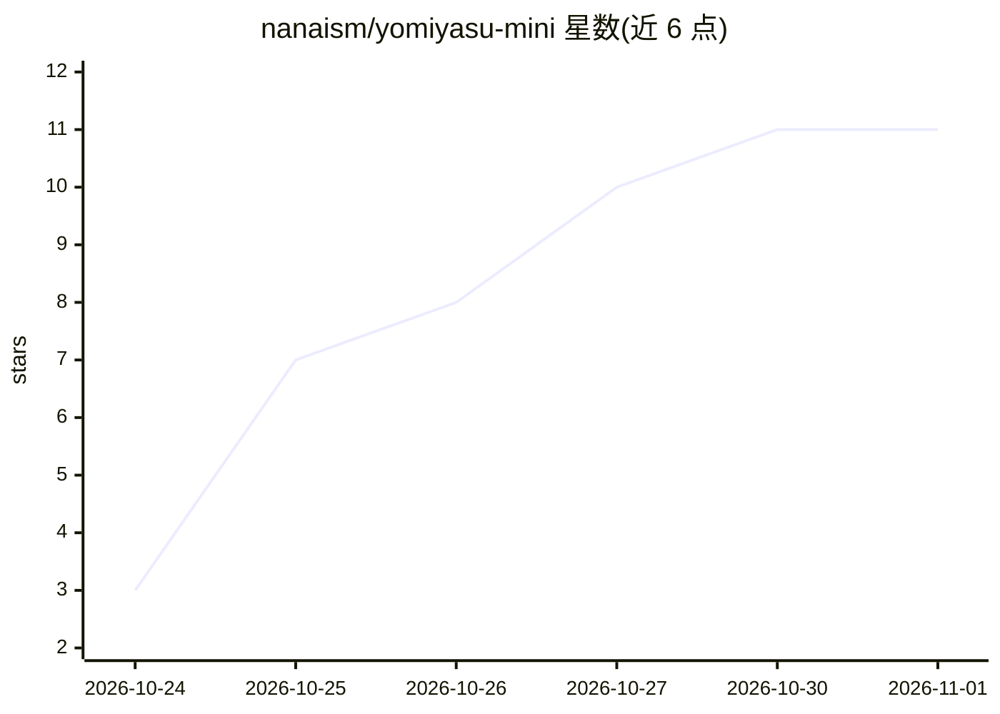

# nanaism/yomiyasu-mini

⭐ 11 · Python · MIT · 推送 2026-10-31 · [GitHub](https://github.com/nanaism/yomiyasu-mini) · 个人维护 · 中文 README

**给有大小上限的 agent 环境用的日语 AI 文本推敲技能（SKILL.md 18,000字以下）**

将日语推敲技能 yomiyasu（本体，SKILL.md 46,311字）压缩为 8 个文件的精简版，适配 Microsoft 365 Copilot Agent Builder 等对字数、文件数、单文件大小有限制的环境：SKILL.md 含 YAML 共 17,959 字，脚本单本 90KB 以下，仅用 Python 标准库。意义保持规则保留在 SKILL.md，细节移入两个参照文件；提供 mini_check.py 等 4 个脚本检测“意义改变风险”，结果与本体 diff 一致。可通过 Claude Code 插件市场、.zip 或直接放置 skills 目录使用；本体可用时 README 建议用本体。

## 筛选速览

| 维度 | 判定 | 备注 |
|---|---|---|
| AI 角色 | `ai-native` | 本体是模型或模型工具 |
| 许可风险 | `permissive` | MIT |
| 部署形态 | `None` |  |
| 模型依赖 | — | README 未给出锁定关系 |
| 硬件要求 | — | 无带数字的原话,不猜 |
| 安装摩擦 | `low` | 无编译、无系统依赖或容器化 |
| 成熟度 | — | 结构信号不足 |

## 能力要点

- SKILL.md 18,000字以下、8 个分发文件、仅标准库运行，每代生成时自动验证上限
- 意义改变风险检测（mini_check.py 等 4 脚本）与本体 yomiyasu_diff.py 输出一致（4,153 输入测试）
- 支持 Claude Code 插件市场安装、Agent Builder .zip 上传、skills 目录手放三种接入方式
- 提供从本体新版本重建 mini 的抽取表与生成脚本（Python 3.9+ 标准库）

## 适用场景

- 在 Microsoft 365 Copilot Agent Builder 等限制技能大小的环境里做日语推敲
- 在 Claude Code 中以插件形式对 AI 写的日语做保义润色
- 推敲后用脚本核查是否存在意义改变风险

## 场景标签

`AI 写作` `提示工程` · 领域:Agent 开发

## 证据(README 行号)

> L7: yomiyasu-mini は、AIが書いた日本語を推敲するスキル yomiyasu（以下「本体」）を、スキルの大きさに上限がある環境に入るように短くしたスキルです。本体 v2.5.0 から、抽出表と生成のスクリプトで作っています。
> L35: mini は SKILL.md を先頭の YAML を含めて18,000字以下、スクリプトを1本90KB以下、参照ファイルを1本100KB以下にし、標準ライブラリだけで動くようにしています。配るファイルは8個で、`.zip` の中
> L92: SKILL.md では、出力の形の指定がなければ、書き直した本文、変えたところ、確認の記録を返すように決めています。残したAIっぽいところと書き手に確かめたい点の欄は、あるときだけ付けます。確認の記録には、検査のスクリプトが出した

## 星数曲线

2026-10-24 3 → 2026-11-01 11（+8）

---
*卡片 v1 · prompt 1.4 · 生成 2026-11-01 · 置信度 high · 依据 README sha `257c8ccfb81d` · [字段定义](../../DATASET.md)*
