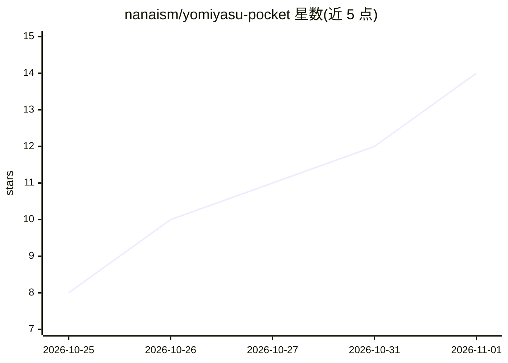

# nanaism/yomiyasu-pocket

⭐ 14 · Python · MIT · 推送 2026-10-30 · [GitHub](https://github.com/nanaism/yomiyasu-pocket) · 个人维护

**让 AI 把日语文章改得更易读的 400-500 字指示文**

一段可粘贴到 AI 指示栏的 400-500 字日文提示词，要求 AI 在不改变意义的前提下改写文章：保持主张、文类、语气强度、数值、固有名词等不变，去除拟人化比喻、直译英语腔等 AI 腔调，且只返回改写后的正文。面向无法安装技能、只能在指示栏粘贴文字的普通用户（如邮件应用中的 AI 校对）。它是大型技能 yomiyasu（46,311 字 SKILL.md）的精简版，本身不含检测脚本，无法用机制核验意义是否偏移。

## 筛选速览

| 维度 | 判定 | 备注 |
|---|---|---|
| AI 角色 | `ai-native` | 本体是模型或模型工具 |
| 许可风险 | `permissive` | MIT |
| 部署形态 | `None` |  |
| 模型依赖 | — | README 未给出锁定关系 |
| 硬件要求 | — | 无带数字的原话,不猜 |
| 安装摩擦 | `low` | 无编译、无系统依赖或容器化 |
| 成熟度 | — | 结构信号不足 |

## 能力要点

- 单一指示文文件（yomiyasu-pocket.txt），粘贴到 AI 指示栏即用
- 约束改写规则：不变意义、不加不减信息、不补未知处
- 指定替换 AI 腔调（拟人比喻、直译英语、多余读点等）
- 附从本体重新生成指示文的 Python 脚本与测量记录

## 适用场景

- 在指示栏有字数限制的 AI 校对功能中改善日语行文
- 日常工作中让聊天 AI 或文档 AI 去除 AI 腔
- 无法安装技能的 AI 环境下做轻量文章推敲

## 场景标签

`提示工程` `AI 写作` · 领域:Agent 开发

## 证据(README 行号)

> L7: yomiyasu-pocket は、AIが書いた日本語を読みやすく整えるための、400〜500字の短い指示文です。yomiyasu（以下「本体」）の決まりのうち、意味を守る決まりと、よく使う直し方だけを短く書き直して入れています。
> L22: AIが書く日本語の癖を直したい人のためのものです。
> L26: メールアプリやドキュメントのAI校正の指示欄、チャット型AIのカスタム指示のように、指示文を貼る欄に入れて使うことを考えて、400〜500字に収めています。文字数に上限がある欄に入るように、この長さにしました。

## 星数曲线

2026-10-25 8 → 2026-11-01 14（+6）

---
*卡片 v1 · prompt 1.4 · 生成 2026-10-31 · 置信度 high · 依据 README sha `f8e7c8b1852d` · [字段定义](../../DATASET.md)*
