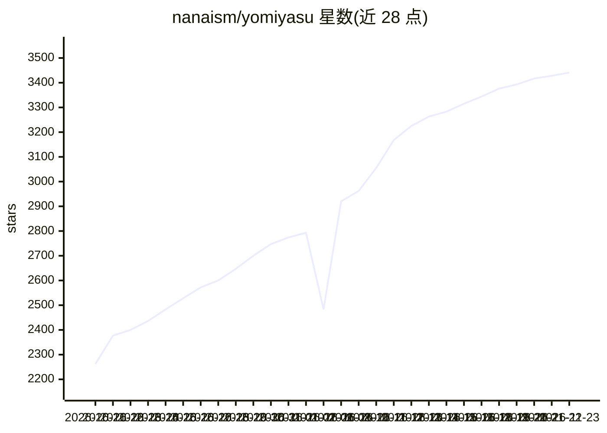

# nanaism/yomiyasu

⭐ 3,441 · Python · MIT · 推送 2026-11-22 · [GitHub](https://github.com/nanaism/yomiyasu) · 组织维护

**供 AI 编码代理加载的日语推敲技能：修整 AI 生成日文**

以 SKILL.md 指示书形式提供的 Agent Skill，用于修改 AI 生成日语中的不自然比喻、模糊主谓关系与多余装饰，并附检查脚本输出可能改变原意的位置。面向技术文章、设计文档、PR 说明、内部报告等实务文本。支持 Claude Code、Codex、Cursor 等编码环境加载，提供 npx skills add、gh skill、openskills、Claude Code 插件、ZIP 注册、复制到 .agents/skills 六种安装方式；另有 mini/pocket 变体供无法加载本体的环境使用。

## 筛选速览

| 维度 | 判定 | 备注 |
|---|---|---|
| AI 角色 | `ai-knowledge` | 知识聚合/清单类 |
| 许可风险 | `permissive` | MIT |
| 部署形态 | `library` | 以包/库形式分发 |
| 模型依赖 | — | README 未给出锁定关系 |
| 硬件要求 | — | 无带数字的原话,不猜 |
| 安装摩擦 | `low` | 无编译、无系统依赖或容器化 |
| 成熟度 | — | 结构信号不足 |

## 能力要点

- 7 条变换原则：主述点检、拟人化整理、比喻平易化、不擅自补充信息等
- 附检查脚本，输出改写前后可能改变语义的位置并向写作者确认
- 六种安装途径（npx skills add / gh skill / openskills / 插件 / ZIP / 复制文件夹）
- 提供 yomiyasu-mini 与 yomiyasu-pocket 两个轻量变体

## 适用场景

- 发布技术文章前让代理按技能推敲草稿
- 整理设计文档与 PR 说明的日语表达
- 在 Claude.ai Web 版通过 ZIP 注册自定义技能

## 场景标签

`AI 写作` · 领域:内容生成

## 证据(README 行号)

> L12: 『**yomiyasu（よみやす）**』はAIが生成した日本語の不自然な比喩、曖昧な主述関係、不要な装飾を直し、読みやすい文章に整えるスキルです。
> L16: Claude Code、Codex、CursorをはじめとするAIコーディング環境に読み込ませて使用してください。本体を入れられない環境のために、本体から作った yomiyasu-mini と yomiyasu-pocket も公
> L50: こうした所を元の意味を保ったまま直すために、yomiyasu は指示書（SKILL.md）と、直す前と後を比べて意味が変わる恐れのある所を出す検査のツールをまとめています。

## 星数曲线

2026-10-21 2,262 → 2026-11-23 3,441（+1,179）

---
*卡片 v1 · prompt 1.4 · 生成 2026-11-23 · 置信度 high · 依据 README sha `5c8ce22f939f` · [字段定义](../../DATASET.md)*
