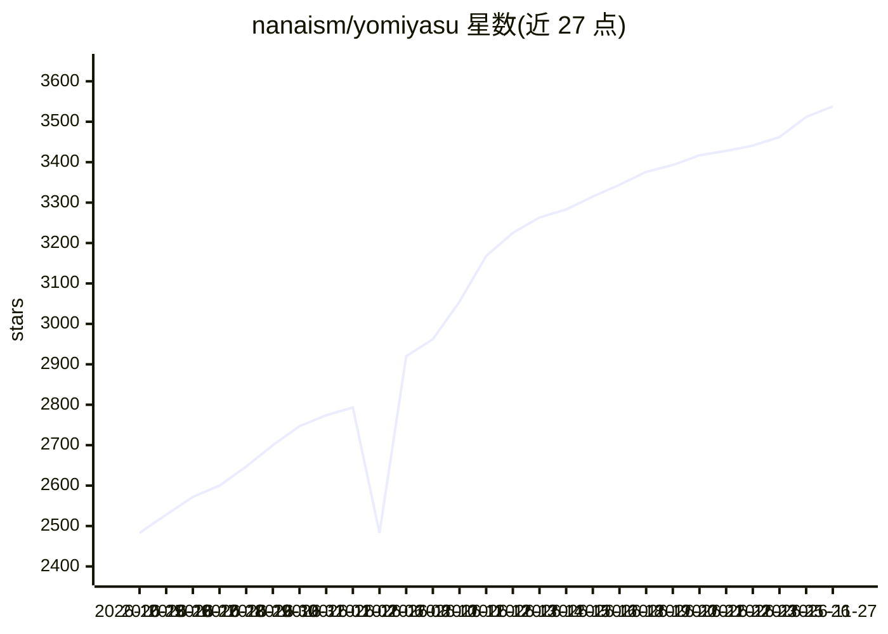

# nanaism/yomiyasu

⭐ 3,538 · Python · MIT · 推送 2026-11-25 · [GitHub](https://github.com/nanaism/yomiyasu) · 组织维护

**把 AI 生成的日语润色成自然日语的 Agent Skill**

yomiyasu 是一个以 SKILL.md 指示书与意义变化检查脚本打包的 Agent Skill，用于修改 AI 生成日语中的不自然比喻、主述模糊与多余装饰，主要面向技术文章、设计文档、PR 说明等实务文本。核心是 7 条转换原则：保持原意优先、保留自然表达、不擅自添加信息、无法确定的改写点作为疑问报告给写作者。提供 npx skills add、gh skill、openskills、Claude Code 插件、ZIP 注册、复制到 Codex 仓库共 6 种安装方式，并为受限环境提供 yomiyasu-mini 与 yomiyasu-pocket 变体。

## 筛选速览

| 维度 | 判定 | 备注 |
|---|---|---|
| AI 角色 | `ai-native` | 本体是模型或模型工具 |
| 许可风险 | `permissive` | MIT |
| 部署形态 | `library` | 以包/库形式分发 |
| 模型依赖 | locked-api |  |
| 硬件要求 | — | 无带数字的原话,不猜 |
| 安装摩擦 | `low` | 无编译、无系统依赖或容器化 |
| 成熟度 | — | 结构信号不足 |

## 能力要点

- 7 条转换原则：保持原意、去拟人化、比喻转平实语言、不添加原文没有的信息
- 无法确定的改写点不擅自处理，作为确认事项报告给写作者
- 6 种安装途径覆盖 Claude Code、Codex、Cursor、Grok Build 等 agent 环境
- 受限环境变体：17 文件的 yomiyasu-mini 与 400-500 字指示文 yomiyasu-pocket

## 适用场景

- 技术文章写完后用 agent 统一润色日语表达
- PR 说明文、提交信息在写入前过一遍推敲
- 在 Claude.ai Web 版或邮件 AI 等无法装 skill 的环境用精简版指示文

## 场景标签

`AI 写作` · 领域:内容生成

## 证据(README 行号)

> L12: 『**yomiyasu（よみやす）**』はAIが生成した日本語の不自然な比喩、曖昧な主述関係、不要な装飾を直し、読みやすい文章に整えるスキルです。
> L50: こうした所を元の意味を保ったまま直すために、yomiyasu は指示書（SKILL.md）と、直す前と後を比べて意味が変わる恐れのある所を出す検査のツールをまとめています。
> L262: yomiyasu は書いた文章を、意味を保ったまま読みやすく整えるスキルです。文書の構成を組むことと、論旨が通っているかを確かめることは受け持ちません。資料から新しく書くこともできますが、構成の型は持っていません。先に文章を書き

## 星数曲线

2026-10-25 2,483 → 2026-11-27 3,538（+1,055）

---
*卡片 v1 · prompt 1.4 · 生成 2026-11-26 · 置信度 high · 依据 README sha `9c334826ac5b` · [字段定义](../../DATASET.md)*
